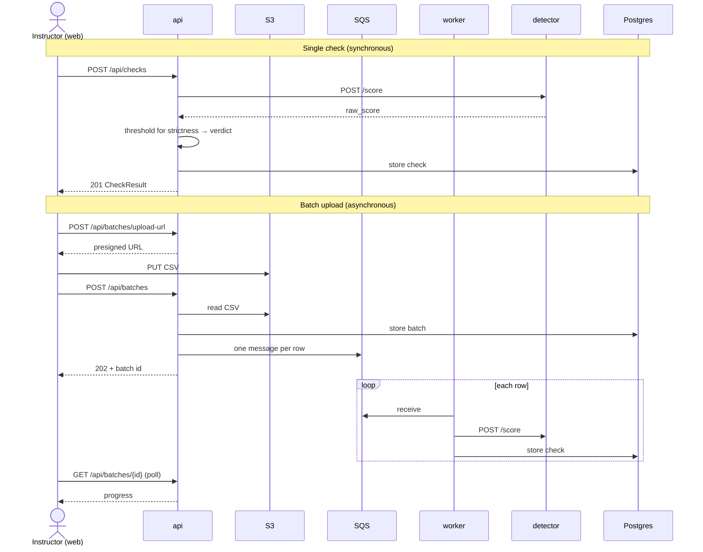
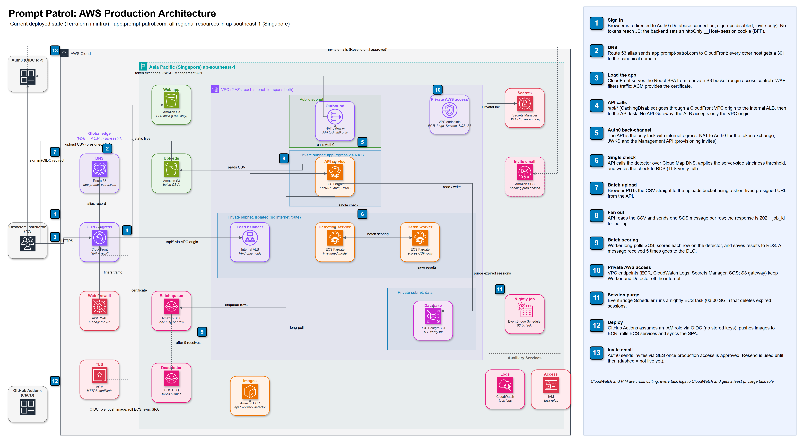

# Prompt-Patrol

[](https://github.com/zylooooo/Prompt-Patrol/actions/workflows/ci.yml)

SMU CS480 Capstone Project: a web-based triage tool that flags potentially AI-generated short student answers for an instructor to review. It is a triage aid, not a verdict system. Every flag is a prompt for human judgement, and `uncertain` is a first-class outcome rather than an error.

## Repo map

| Path                                                 | What it is                                                                                          |
| ---------------------------------------------------- | --------------------------------------------------------------------------------------------------- |
| [`apps/api`](apps/api/README.md)                     | FastAPI + SQLAlchemy + Postgres backend, Auth0 sign-in. Owns persistence, authorization and audit   |
| [`apps/web`](apps/web/README.md)                     | React 19 + TypeScript + Vite frontend                                                               |
| [`apps/detector`](apps/detector/README.md)           | Stateless scoring service: text in, `[0,1]` score out. No database, no user identity, no thresholds |
| [`apps/worker`](apps/worker/README.md)               | SQS poll loop that processes batch uploads through the same code path as a single check             |
| `apps/e2e`                                           | Throwaway stack for the Playwright smoke suite — see [End-to-end tests](#end-to-end-tests)          |
| [`apps/data-pipeline`](apps/data-pipeline/README.md) | Corpus tooling: dataset ingest and cleaning, the AI-answer generation harness, and the splicer      |
| [`ml-training`](ml-training/README.md)               | Detector training, evaluation and MLflow tracking                                                   |
| [`docs/openapi.yaml`](docs/openapi.yaml)             | The API contract, with a changelog and decision log at the bottom                                   |
| `postman/`                                           | Postman collection and environment for exercising the API by hand                                   |
| [`PRODUCT.md`](PRODUCT.md), [`DESIGN.md`](DESIGN.md) | Product context and the frontend design system                                                      |

## Architecture



The worker runs each row through the same `create_check` the single-check route uses, so a batch row and a single check produce the same result. The detector only ever returns a score — verdicts, thresholds, identity and persistence all stay in the API. Locally, LocalStack stands in for S3 and SQS.

### AWS deployment



Production runs at <https://app.prompt-patrol.com>, with every regional resource in `ap-southeast-1` (Singapore) so student data stays in Singapore. The numbered steps in the diagram are explained in its side panel. In short:

- **Edge.** CloudFront serves the SPA from a private S3 bucket and forwards `/api/*` through a VPC origin to an internal ALB. WAF and the ACM certificate sit in `us-east-1`, as CloudFront requires. There is no API Gateway, and the ALB accepts traffic only from the VPC origin.
- **Compute.** The api, worker and detector run as separate ECS Fargate services in private subnets. The api reaches the detector over Cloud Map DNS, and the worker long-polls SQS (with a DLQ) for batch rows.
- **Egress.** Only the api task can reach the internet, through a NAT gateway, and only for the Auth0 token exchange, JWKS and Management API. Everything else uses VPC endpoints, so the worker and detector have no internet route.
- **Data.** Checks and batches are stored in RDS PostgreSQL over TLS `verify-full`, uploaded CSVs in S3, and secrets in Secrets Manager.
- **Delivery.** GitHub Actions assumes a deploy role via OIDC (no stored keys), pushes images to ECR, rolls the ECS services and syncs the SPA.

The diagram source is [`docs/assets/prompt-patrol-aws-architecture.drawio`](docs/assets/prompt-patrol-aws-architecture.drawio). Edit it in draw.io and re-export the PNG when the infrastructure changes. [`infra/README.md`](infra/README.md) covers how each piece is provisioned.

## Local dev

1. `cd apps && docker compose up -d --build` — starts Postgres, LocalStack (S3 + SQS), the detector service, the API, the batch worker, and an nginx-served production build of the frontend on <http://localhost:5173>. The API reads `apps/api/.env` (copy it from `.env.example`), and `apps/api/app/config/settings.py` refuses to start unless all six `AUTH0_*` variables are set — an incomplete Auth0 configuration is a startup failure rather than a runtime one, on the grounds that an app nobody can sign into should say so immediately. The API also applies migrations on start (`apps/api/entrypoint.sh`), so the tables are there by the time it answers its health check. A failed migration stops the container rather than leaving it serving errors, so `docker compose logs api` is the first place to look if it does not come up.
2. `docker exec prompt-patrol-api sh -c "cd /app && python -m scripts.provision_user add <your-dev-tenant-email> root_admin"` — allowlist yourself; there's no self-service signup. This also creates your Auth0 credential — Auth0 emails you a one-time link to set your password before signing in. Must be run as `-m scripts.provision_user`, not `python scripts/provision_user.py` — the latter fails with `ModuleNotFoundError: No module named 'db'` since Python puts the script's own folder on `sys.path` instead of the app root.
To apply a migration you have just written without restarting anything, `docker exec prompt-patrol-api alembic upgrade head` still works — it runs inside the container, so it uses the container's `DB_URL` and there is no host/`localhost` hostname mismatch to worry about.

The frontend container is a production build, so it does not pick up edits. To work on the frontend with hot reload, stop it (`docker compose stop frontend`) and run the Vite dev server instead — see [the frontend README](apps/web/README.md).

### Running the fine-tuned detector

The default stack serves the RoBERTa baseline. To serve the fine-tuned desklib model instead, layer the override file on top:

```sh
cd apps && docker compose -f docker-compose.yml -f docker-compose.desklib.yml up -d --build
```

The override swaps the detector image and sets the matching model version, threshold and abstention band on the API and worker, so the three stay in step. The first build downloads a ~1.7 GB base model, and Docker needs roughly 8 GB of memory. See [`apps/detector`](apps/detector/README.md) for details.

## Tests

| Package              | Command (from the package folder)                              |
| -------------------- | -------------------------------------------------------------- |
| `apps/api`           | `pytest`                                                       |
| `apps/detector`      | `pip install -r requirements-dev.txt && pytest`                |
| `apps/worker`        | `pytest`                                                       |
| `apps/data-pipeline` | `pip install -r requirements-dev.txt && pytest`                |
| `apps/web`           | `npm test` (Vitest), `npm run lint`, `npm run typecheck`       |
| `docs/openapi.yaml`  | `npx @redocly/cli lint docs/openapi.yaml` (from the repo root) |

### End-to-end tests

`cd apps/web && npm run test:e2e` — runs the Playwright smoke suite against its own throwaway stack (`apps/e2e/docker-compose.yml`), built, seeded and torn down by that one command. Stop the dev stack first, since both bind the same ports. Auth0 and the detector are stubbed — see [the frontend README](apps/web/README.md#end-to-end-tests) for what that covers and why.

## The API contract

[`docs/openapi.yaml`](docs/openapi.yaml) is the agreed shape of every endpoint, and changes to the API start there: update the contract (with a changelog and decision-log entry), then the code. Read the decision log before "fixing" something that looks inconsistent — most of the odd-looking choices, such as `404` instead of `403` on another instructor's resource, are deliberate and explained there.
