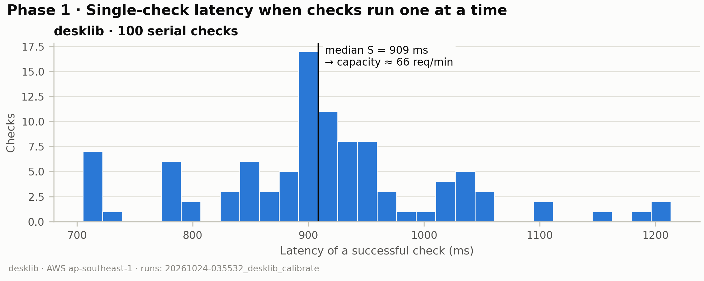
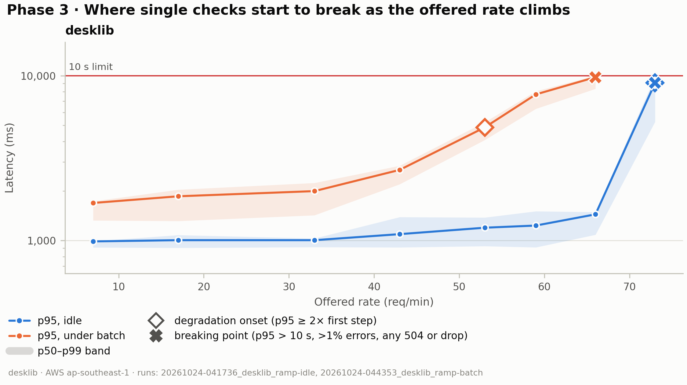
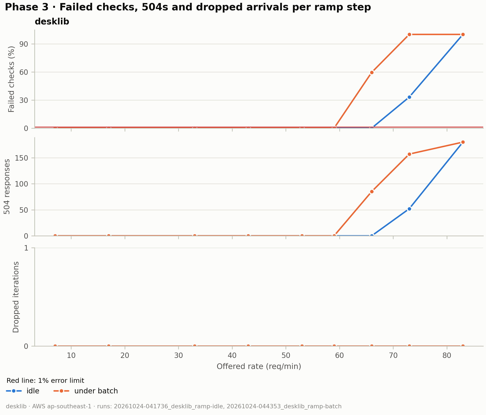
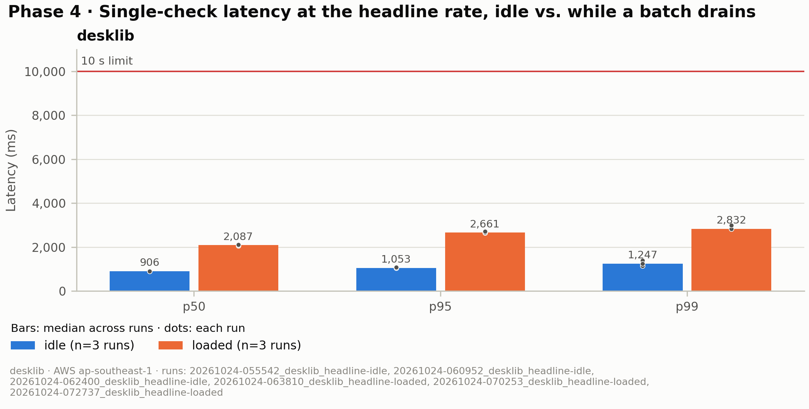
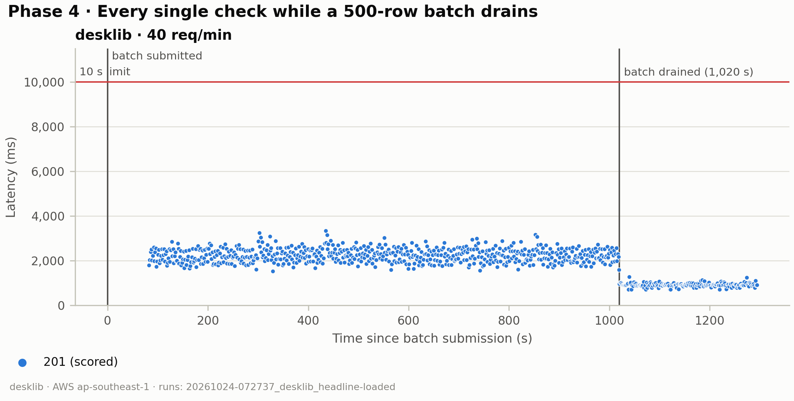
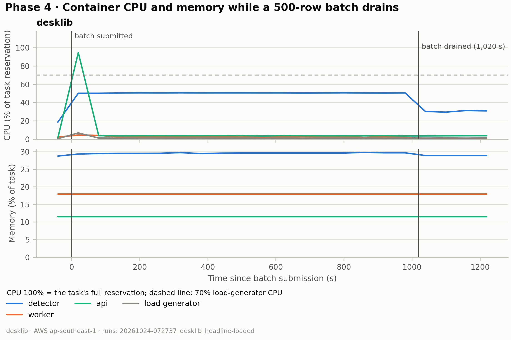
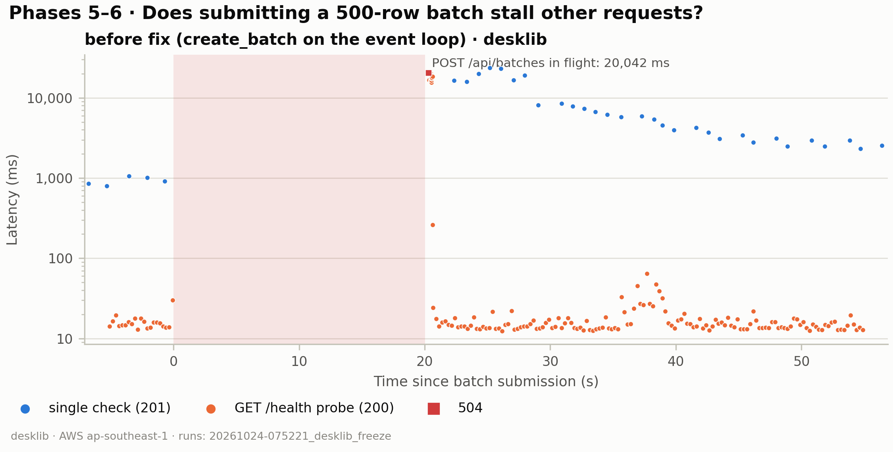

# PP-533 load test — results

_Generated by `render.py` from `results/`. Edit only inside `<!-- hand:… -->` blocks; everything else is rewritten on every render (`run.sh render`)._

## Method

- **Stack.** The deployed AWS stack: CloudFront, then WAF (the load generator's Elastic IP is
  exempted from the rate rules), then a VPC origin to the internal ALB, then one Fargate task per
  service (api, worker, detector), with RDS Postgres and SQS/S3 behind them. Requests authenticate
  with a real session cookie, so the measured path is the production path minus Auth0.
- **Task sizes** (from `meta.json`): api 0.5 vCPU / 1024 MiB; worker 0.25 vCPU / 512 MiB; detector 2 vCPU / 8192 MiB.
- **Load generator:** an EC2 t3.small instance in ap-southeast-1
  (same Region as the stack), running k6 v2.3.0 with an open
  workload model (arrival-rate executors), so a slow server cannot slow the arrivals down.
- **Code under test:** git 09121bb.
- **Workload.** `POST /api/checks` with a random short answer (strictness `standard`). Each run
  starts with 20 serial warm-up checks that are excluded from every number. Latency figures use
  successful checks only (201 with a verdict) so a fast error never looks like good latency;
  failures count in the error rate. Phases: 1 calibrate (100 serial checks, S = median),
  3 stepped ramp at 0.1–1.25 × 60/S req/min (2 min plateaus, idle and under 500-row batches),
  4 headline constant rate (idle 10 min; loaded until one 500-row batch drains), 5–6 batch
  submission freeze before/after the `create_batch` fix.

## Prediction (Phase 2)

<!-- hand:prediction -->
_Copied from EXPERIMENT_LOG.md Entry 2, written before Phase 3 ran._

Calibrate (`20261024-035532_desklib_calibrate`): S = 0.909 s, p95 1.10 s, so
C ≈ 66 checks/min on one detector task (2 vCPU). S is end to end, so the
detector's own capacity is slightly above 66.

**ramp-idle.** Arrivals are evenly spaced and service time is nearly constant,
so I expect almost no queueing below C:

- 7–53/min (≤ 0.8C): flat, p95 ≈ 1.1–1.3 s.
- **Onset at 59–66/min (0.9–1.0C):** p95 rises to roughly 1.5–3 s as checks
  begin to overlap and share the 2 vCPU (the detector runs inference in a
  threadpool with no lock).
- **Break at 73/min (1.1C):** about 7 checks/min more than C arrive. Over a
  2-minute plateau that is a backlog of ~14 checks × 0.9 s ≈ 13 s, so
  p95 > 10 s (NFR3 fails) and the API's 10 s detector timeouts start.
- 83/min (1.25C): collapse. Timed-out checks still use detector CPU, so
  successful throughput falls *below* C and most requests fail.

**ramp-batch.** The worker sends batch rows to the same detector, so the batch
takes part of C away from single checks. I expect onset and break to move about
one step lower each: onset ~0.65–0.8C, break ~0.9–1.0C.

**What would prove this wrong:** if one inference doesn't use both vCPU,
overlapping checks run in parallel and C is effectively higher than 66. Then
the ramp shows no onset until 1.1–1.25C. That is a finding about the
detector's concurrency in its own right.
<!-- /hand:prediction -->

## Results

### Phase 1 — calibration

| Model | Run | OK checks | p50 ms | p95 ms | p99 ms | S (s, from k6) | Capacity 60/S (req/min) |
|---|---|---|---|---|---|---|---|
| desklib | `20261024-035532_desklib_calibrate` | 100 | 909 | 1,100 | 1,201 | 0.909 | 66 |

### Phase 3 — stepped ramp

_Achieved req/min is completion throughput (k6 stamps each request when it completes), not the arrival rate: under overload it falls below the offered rate._

**desklib, idle** (`20261024-041736_desklib_ramp-idle`): onset 73 req/min, breaking point 73 req/min.

| Offered req/min | Achieved req/min (completions) | p50 ms | p95 ms | p99 ms | Errors | 504 | Dropped | Marker |
|---|---|---|---|---|---|---|---|---|
| 7 | 7.0 | 909 | 988 | 989 | 0.0% | 0 | 0 |  |
| 17 | 16.9 | 903 | 1,005 | 1,081 | 0.0% | 0 | 0 |  |
| 33 | 32.7 | 913 | 1,005 | 1,031 | 0.0% | 0 | 0 |  |
| 43 | 42.7 | 909 | 1,094 | 1,389 | 0.0% | 0 | 0 |  |
| 53 | 52.6 | 925 | 1,197 | 1,380 | 0.0% | 0 | 0 |  |
| 59 | 58.9 | 909 | 1,233 | 1,506 | 0.0% | 0 | 0 |  |
| 66 | 65.4 | 1,085 | 1,442 | 1,490 | 0.0% | 0 | 0 |  |
| 73 | 68.1 | 5,258 | 9,054 | 9,854 | 33.1% | 52 | 0 | onset **breaking** |
| 83 | 82.6 | — | — | — | 100.0% | 180 | 0 |  |

**desklib, under batch** (`20261024-044353_desklib_ramp-batch`): onset 53 req/min, breaking point 66 req/min.

| Offered req/min | Achieved req/min (completions) | p50 ms | p95 ms | p99 ms | Errors | 504 | Dropped | Marker |
|---|---|---|---|---|---|---|---|---|
| 7 | 7.0 | 1,325 | 1,691 | 1,731 | 0.0% | 0 | 0 |  |
| 17 | 17.0 | 1,314 | 1,856 | 2,037 | 0.0% | 0 | 0 |  |
| 33 | 32.6 | 1,424 | 1,995 | 2,238 | 0.0% | 0 | 0 |  |
| 43 | 42.1 | 2,197 | 2,684 | 2,845 | 0.0% | 0 | 0 |  |
| 53 | 51.9 | 4,076 | 4,862 | 5,227 | 0.0% | 0 | 0 | onset |
| 59 | 57.9 | 6,302 | 7,707 | 8,060 | 0.0% | 0 | 0 |  |
| 66 | 64.0 | 8,336 | 9,803 | 10,012 | 59.4% | 85 | 0 | **breaking** |
| 73 | 72.8 | — | — | — | 100.0% | 157 | 0 |  |
| 83 | 82.6 | — | — | — | 100.0% | 180 | 0 |  |

### Phase 4 rate choice

<!-- hand:rate-choice -->
R = 40 req/min, which is 60% of the under-batch breaking point (66) and below the
onset (53). We went above the usual 50% to make the test harder, but stayed under
the onset on purpose: k6 sends requests evenly spaced, real instructors don't, so
the ~40% headroom is there for bursts the test can't model.

We also did one stress run at R = 53 (the onset) to see if the system still holds
for a full batch drain right at the edge. It's kept in `results/_stress/` so it
doesn't mix into the AC4 numbers: p95 5.0 s, 0 errors, batch drain 1,884 s.

The real demand figure is still a placeholder (3 instructors × 4 checks/min =
12/min). It needs confirming with the sponsor, since it's what R = 40 is measured
against.
<!-- /hand:rate-choice -->

### Phase 4 — headline

Percentiles and error rate: median across runs. 504s and dropped: totals across runs.

| Model | Condition | Runs | Rate (req/min) | p50 ms | p95 ms | p99 ms | Errors | 504 | Dropped | Batch drain (s) |
|---|---|---|---|---|---|---|---|---|---|---|
| desklib | idle | 3 | 40 | 906 | 1,053 | 1,247 | 0.0% | 0 | 0 | — |
| desklib | loaded | 3 | 40 | 2,087 | 2,661 | 2,832 | 0.0% | 0 | 0 | 1,015, 1,016, 1,020 |

### Phases 5–6 — `create_batch` freeze

| Run | Model | Variant | POST /api/batches ms (freeze) | /health p95 ms | /health max ms | Failed /health | Check p95 ms | 504 | Batch drain (s) |
|---|---|---|---|---|---|---|---|---|---|
| `20261024-075221_desklib_freeze` | desklib | sync | 20,042 | 18,176 | 20,199 | 0 | 8,291 | 1 | — |

_Figure 7 shows desklib only (one model, so before/after compare like with like); no async run yet._

### Model comparison

_Figure 8 (model comparison): needs charted runs of both models; not yet run._

## Discussion

<!-- hand:discussion -->
**The prediction mostly held.** Idle broke at 73/min (1.1C), exactly the predicted
step, and at 83/min every check timed out even though the detector kept working.
Under batch, onset 53 and break 66, inside the predicted range. What we didn't
predict: a running batch costs single checks about 45% more latency even at
7/min, and at the top steps 33 batch rows failed their first try (all went
through on retry).

**Sharing one detector between checks and batches works at R = 40.** With a
500-row batch draining, p95 went from 1.05 s to 2.66 s, with 0 errors across 3
runs. The batch drains in about 17 min. The 2-minute ramp plateau predicted this
well, so the ramp is a good guide for future capacity checks.

**Submitting a batch freezes the API for ~20 s.** `POST /api/batches` took 19–21 s
every time (5 out of 5). While it ran, the API answered nothing: the event-loop
probe went from ~15 ms to 20 s (Figure 7), and API CPU jumped to ~95% (Figure 6).
Checks caught in that window took up to ~21 s and one got a 504. This is the only
NFR3 failure we found, and it comes from the API, not the detector.

**The detector only uses one of its two vCPU.** Detector CPU sat at exactly ~50%
of the task for the whole 17-min drain, while it was fully busy (Figure 6), and
never went above 51% in any run, even when every check was timing out. So the
66/min capacity is a one-core number. We think PyTorch is picking one thread on
Fargate's vCPU, but this still needs confirming. Memory peaked at ~3 GB of 8 GB.

**GPU isn't justified yet.** A check takes 0.91 s against a 10 s limit, and
capacity is ~4× the placeholder demand. Before paying for a GPU, use the second
core, then add detector tasks.
<!-- /hand:discussion -->

## AC4 verdict

Thresholds: p95 < 10,000 ms (median of runs), 504 = 0, check success > 99% (pooled), dropped iterations = 0 (totals across runs).

| Model | Condition | Runs | p95 ms | 504 | Check success | Dropped |
|---|---|---|---|---|---|---|
| desklib | idle | 3 | 1,053 PASS | 0 PASS | 100.0% PASS | 0 PASS |
| desklib | loaded | 3 | 2,661 PASS | 0 PASS | 100.0% PASS | 0 PASS |

<!-- hand:verdict -->
**desklib: PASS** at R = 40, idle and while a 500-row batch drains (p95 2.66 s,
0 504s, 100% success, 0 dropped), so the shared-detector design holds.

**One caveat:** batch submission itself fails NFR3 for about 20 s each time. The
fix we'd choose is to take `create_batch`'s heavy work off the API's event loop
(run it in a thread or hand it to the worker) and re-measure with
`freeze --variant async` and `headline-loaded --variant async` (Phase 6). No
detector change is needed for AC4.
<!-- /hand:verdict -->

## Limitations

- **1-minute metric resolution.** CloudWatch / Container Insights points are one per minute, so
  short spikes in CPU and memory are averaged away.
- **One task per service, no autoscaling.** api, worker and detector each run a single Fargate
  task; the results describe that fixed size, not what scaling out would give.
- **No last-mile client latency.** The load generator sits in the same Region as the stack, so
  numbers exclude the network between an instructor's browser and CloudFront.
- **Short-answer workload.** Answers come from the project's short-answer corpus. Longer
  answers cost the detector more per check, so capacity for long answers will be lower.
- **Campus-shared IP vs. WAF rate limit.** `rate-writes` is per IP. Instructors on the campus
  network probably share one public IP, so together they get ~1 write/s (checks, batch submits,
  user admin) before WAF returns 403. At current usage this is likely fine, but it is a real
  production limit. The load generator is exempted from the rule, so these runs do not show it.

## Runs not charted

- `20261023-162238_stub_smoke`: smoke test (plumbing check, never charted)
- `20261023-165833_stub_smoke`: smoke test (plumbing check, never charted)
- `20261024-030558_stub_smoke`: smoke test (plumbing check, never charted)

## Excluded runs

_None._
