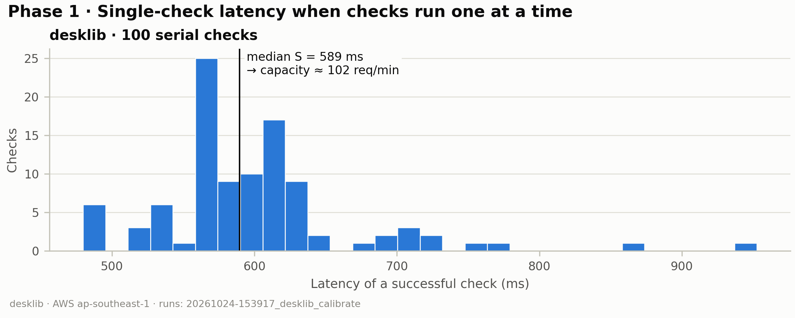
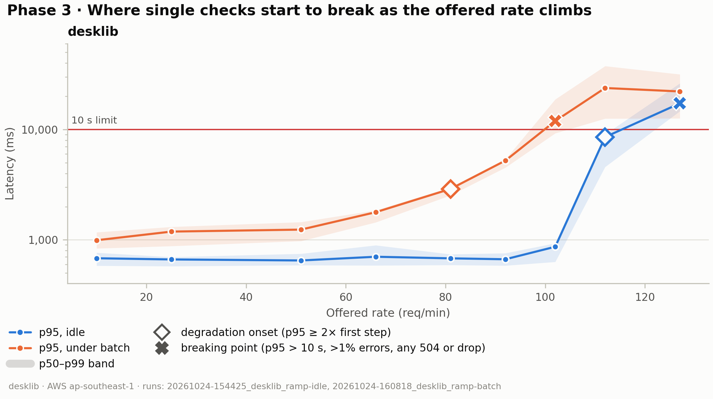
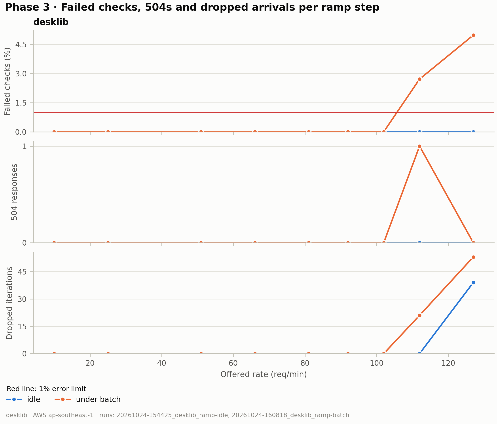
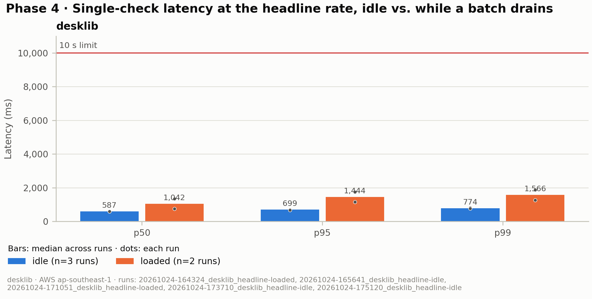
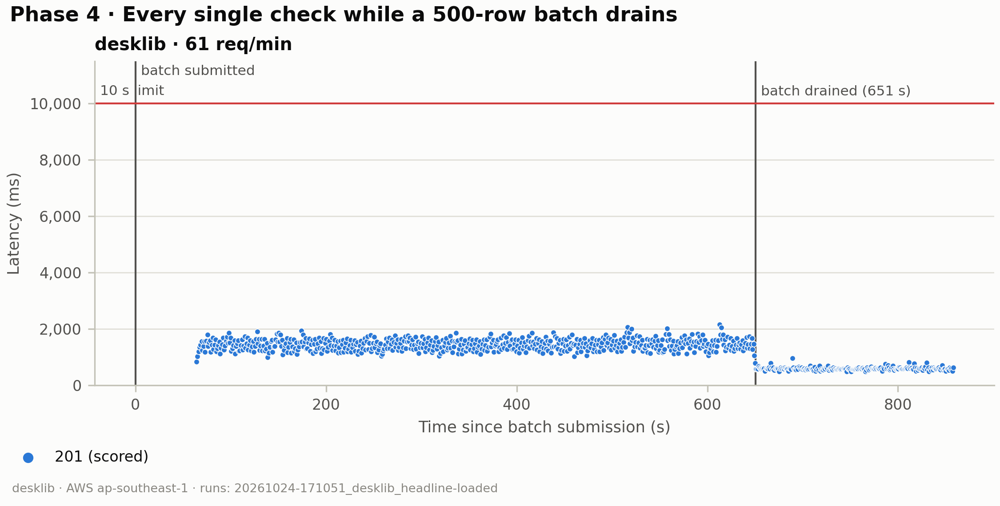
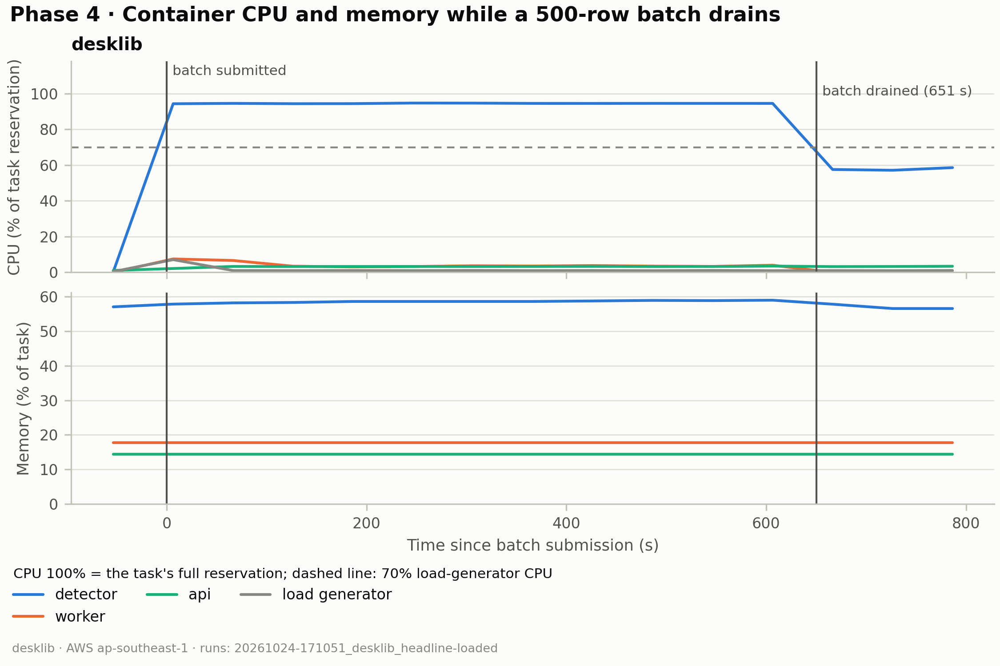
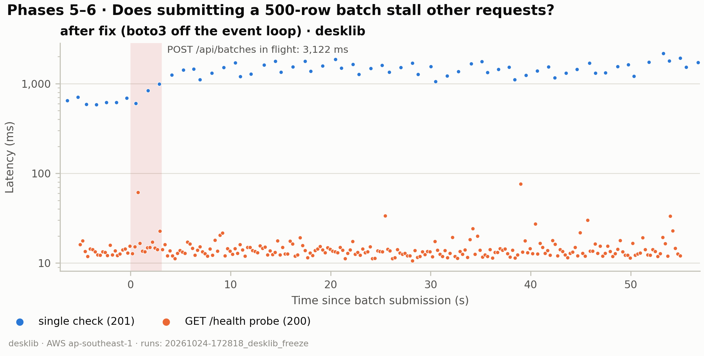

# PP-533 load test — results

_Generated by `render.py` from `results/`. Edit only inside `<!-- hand:… -->` blocks; everything else is rewritten on every render (`run.sh render`)._

## Method

- **Stack.** The deployed AWS stack: CloudFront, then WAF (the load generator's Elastic IP is
  exempted from the rate rules), then a VPC origin to the internal ALB, then one Fargate task per
  service (api, worker, detector), with RDS Postgres and SQS/S3 behind them. Requests authenticate
  with a real session cookie, so the measured path is the production path minus Auth0.
- **Task sizes** (from `meta.json`): api 0.5 vCPU / 1024 MiB; worker 0.25 vCPU / 512 MiB; detector 2 vCPU / 4096 MiB.
- **Load generator:** an EC2 t3.small instance in ap-southeast-1
  (same Region as the stack), running k6 v2.3.0 with an open
  workload model (arrival-rate executors), so a slow server cannot slow the arrivals down.
- **Code under test:** git 0ca0f61.
- **Workload.** `POST /api/checks` with a random short answer (strictness `standard`). Each run
  starts with 20 serial warm-up checks that are excluded from every number. Latency figures use
  successful checks only (201 with a verdict) so a fast error never looks like good latency;
  failures count in the error rate. Phases: 1 calibrate (100 serial checks, S = median),
  3 stepped ramp at 0.1–1.25 × 60/S req/min (2 min plateaus, idle and under 500-row batches),
  4 headline constant rate (idle 10 min; loaded until one 500-row batch drains), 5–6 batch
  submission freeze before/after the `create_batch` fix.

## Prediction (Phase 2)

<!-- hand:prediction -->
_This report covers Phases 7 and 8 (2026-10-24, git 0ca0f61, detector 2 vCPU / 4 GB). The
first AC4 report is `../RESULTS.md`. Every run here was on a detector task with the same host
CPU, Intel Xeon 6975P-C (read from the `torch threads` log line at task start)._

**Prediction (EXPERIMENT_LOG Entry 5, before any run).** Torch on both vCPU cuts S by
1.5–1.9× and detector CPU goes from ~50% to near 100%. Memory peaks near 3 GB of 4.
Keep two threads only if S drops by more than 10%.

### Phase 7 — one vs. two torch threads, same CPU model

Arm A: `DETECTOR_TORCH_THREADS=1`. Arm B: unset (one thread per vCPU = 2). Same code, same
host CPU model, back to back. Runs in `results/_phase7/threads1/` and `threads2/`.

| Measure | A: 1 thread | B: 2 threads |
|---|---|---|
| S (calibrate median) | 0.591 s | 0.589 s |
| Calibrate p95 | 726 ms | 717 ms |
| Detector CPU peak (ramp-idle) | 50% | 95% |
| ramp-idle onset / break | 112 / 127 per min | 112 / 127 per min |
| Max completions (top steps) | ~104–106 per min | ~104–105 per min |
| Detector memory peak (ramp-idle) | 66% of 4 GB | 65% of 4 GB |

**The prediction was wrong.** The second thread works (CPU doubles to 95%) but does no useful
work: S is the same to within 0.3%, and so is capacity at every ramp step. Most likely the
2 vCPU are two hyperthreads of one physical core, so a second thread only competes with the
first for the same core. That is not proven (the task doesn't log its core layout), but it
is the simplest story that fits a doubled CPU with no speed-up.

**Decision by the rule set in advance: reject two threads.** S dropped by 0.3%, well under
the 10% bar.
<!-- /hand:prediction -->

## Results

### Phase 1 — calibration

| Model | Run | OK checks | p50 ms | p95 ms | p99 ms | S (s, from k6) | Capacity 60/S (req/min) |
|---|---|---|---|---|---|---|---|
| desklib | `20261024-153917_desklib_calibrate` | 100 | 589 | 717 | 868 | 0.589 | 102 |

### Phase 3 — stepped ramp

_Achieved req/min is completion throughput (k6 stamps each request when it completes), not the arrival rate: under overload it falls below the offered rate._

**desklib, idle** (`20261024-154425_desklib_ramp-idle`): onset 112 req/min, breaking point 127 req/min.

| Offered req/min | Achieved req/min (completions) | p50 ms | p95 ms | p99 ms | Errors | 504 | Dropped | Marker |
|---|---|---|---|---|---|---|---|---|
| 10 | 10.0 | 583 | 681 | 765 | 0.0% | 0 | 0 |  |
| 25 | 24.6 | 577 | 664 | 699 | 0.0% | 0 | 0 |  |
| 51 | 50.2 | 589 | 650 | 748 | 0.0% | 0 | 0 |  |
| 66 | 65.4 | 586 | 703 | 893 | 0.0% | 0 | 0 |  |
| 81 | 80.4 | 591 | 680 | 740 | 0.0% | 0 | 0 |  |
| 92 | 91.6 | 584 | 667 | 757 | 0.0% | 0 | 0 |  |
| 102 | 101.5 | 631 | 866 | 931 | 0.0% | 0 | 0 |  |
| 112 | 104.8 | 4,579 | 8,545 | 9,047 | 0.0% | 0 | 0 | onset |
| 127 | 104.2 | 14,648 | 17,258 | 26,214 | 0.0% | 0 | 39 | **breaking** |

**desklib, under batch** (`20261024-160818_desklib_ramp-batch`): onset 81 req/min, breaking point 102 req/min.

| Offered req/min | Achieved req/min (completions) | p50 ms | p95 ms | p99 ms | Errors | 504 | Dropped | Marker |
|---|---|---|---|---|---|---|---|---|
| 10 | 10.0 | 836 | 992 | 1,171 | 0.0% | 0 | 0 |  |
| 25 | 24.7 | 878 | 1,188 | 1,311 | 0.0% | 0 | 0 |  |
| 51 | 50.0 | 975 | 1,238 | 1,449 | 0.0% | 0 | 0 |  |
| 66 | 65.1 | 1,441 | 1,781 | 1,855 | 0.0% | 0 | 0 |  |
| 81 | 79.6 | 2,533 | 2,895 | 2,982 | 0.0% | 0 | 0 | onset |
| 92 | 89.7 | 4,519 | 5,228 | 5,359 | 0.0% | 0 | 0 |  |
| 102 | 84.9 | 9,245 | 11,943 | 18,773 | 0.0% | 0 | 0 | **breaking** |
| 112 | 98.2 | 12,557 | 23,778 | 37,583 | 2.7% | 1 | 21 |  |
| 127 | 100.3 | 12,615 | 22,128 | 31,630 | 5.0% | 0 | 53 |  |

### Phase 4 rate choice

<!-- hand:rate-choice -->
Two rates, as planned in Entry 5:

- **R = 40/min**, the same load as the first AC4, so the two can be compared directly.
- **R2 = 61/min** = 60% of the new under-batch breaking point (102/min), the same rule that
  gave 40 last time.

render.py pools both rates into one row in the table and Figure 4 below. The split by rate is:

| Rate | Condition | Run | p50 ms | p95 ms | p99 ms | Errors | 504 | Batch drain |
|---|---|---|---|---|---|---|---|---|
| 40 | idle | `165641` | 584 | 699 | 774 | 0% | 0 | — |
| 40 | idle | `175120` | 587 | 665 | 757 | 0% | 0 | — |
| 40 | loaded | `164324` | 751 | 1,150 | 1,257 | 0% | 0 | 455 s |
| 61 | idle | `173710` | 591 | 705 | 816 | 0% | 0 | — |
| 61 | loaded | `171051` | 1,333 | 1,738 | 1,874 | 0% | 0 | 651 s |

**Against earlier runs at R = 40 (loaded):**

| | First AC4 | Phase 6 | Phase 8 |
|---|---|---|---|
| Torch threads | default (1) | default (1) | 2 |
| S | 0.909 s | 0.578 s | 0.589 s |
| Loaded p95 | 2,661 ms (3 runs) | 1,031 ms (3 runs) | 1,150 ms (1 run) |
| Batch drain | ~1,016 s | 401–421 s | 455 s |

**Only one or two runs per cell.** The session cookie hit its 4-hour cap at 18:12 UTC. The
queue ran one of each type first, then repeats while time was left. Not run: the third
idle run at 40, the second and third loaded runs at 40 and 61, and idle runs 2–3 at 61.
<!-- /hand:rate-choice -->

### Phase 4 — headline

Percentiles and error rate: median across runs. 504s and dropped: totals across runs.

| Model | Condition | Runs | Rate (req/min) | p50 ms | p95 ms | p99 ms | Errors | 504 | Dropped | Batch drain (s) |
|---|---|---|---|---|---|---|---|---|---|---|
| desklib | idle | 3 | 40, 61 | 587 | 699 | 774 | 0.0% | 0 | 0 | — |
| desklib | loaded | 2 | 40, 61 | 1,042 | 1,444 | 1,566 | 0.0% | 0 | 0 | 455, 651 |

### Phases 5–6 — `create_batch` freeze

| Run | Model | Variant | POST /api/batches ms (freeze) | /health p95 ms | /health max ms | Failed /health | Check p95 ms | 504 | Batch drain (s) |
|---|---|---|---|---|---|---|---|---|---|
| `20261024-172818_desklib_freeze` | desklib | async | 3,122 | 20 | 76 | 0 | 1,718 | 0 | — |

_Figure 7 shows desklib only (one model, so before/after compare like with like); no sync run yet._

### Model comparison

_Figure 8 (model comparison): needs charted runs of both models; not yet run._

## Discussion

<!-- hand:discussion -->
**Phase 8 beats the first AC4 on every number, but the hardware did that, not the second
thread.** Compared with the first AC4: S went from 0.909 to 0.589 s, the idle break from 73
to 127/min, the under-batch break from 66 to 102/min, and loaded p95 at 40/min from 2.66 to
1.15 s. Phase 7 shows that on the same CPU, one thread and two threads give the same S and
the same breaking points. So all of the gain comes from the faster host CPU (Xeon 6975P-C),
which Fargate doesn't guarantee. A later deploy could land on a slower host and lose it.

**Under mixed load, two threads may even be slightly worse.** Loaded at 40/min: p95 1.15 s
and a 455 s drain, against 1.03 s and 401–421 s for Phase 6's single thread at almost the
same S. One run against three, and Phase 6's CPU model wasn't logged, so this is a hint,
not a result. It does fit the hyperthread story: two busy threads share one core.

**At R2 = 61/min the system still has plenty of headroom.** Idle p95 is 0.71 s and loaded
p95 is 1.74 s, with 0 errors and a 500-row batch drained in 651 s (~11 min). Both are far
under the 10 s limit.

**The freeze is still fixed, now at 61/min.** `POST /api/batches` took 3.1 s. The event-loop
probe had p95 20 ms and max 76 ms (Phase 6: 30 ms / 256 ms), with 0 504s
(`20261024-172818_desklib_freeze`).

**4 GB is enough.** Detector memory peaked at 70% of 4 GB (~2.8 GiB) in the ramp-batch
overload steps and ~59% in the headline runs, with no task restart. That is under the 85% bar.

**Overload now shows up as slow checks, not 504s.** At 127/min, ramp-idle p95 was ~17 s with
0 errors and 0 504s. In the first AC4, checks over ~10 s got 504s. The API's 10 s budget only
wraps the detector call (`asyncio.wait_for` in `create_check`), so these checks waited before
that call started. API CPU stayed at ~5%, so it isn't the API's CPU. **Hypothesis
(unconfirmed):** the API holds a DB connection for the whole check. SQLAlchemy's default pool
is 5 + 10 = 15, so about 15 checks are in flight and the rest queue for a connection, outside
the 10 s budget. At S = 0.59 s, 15 queued detector calls take ~9 s, so none time out; at
S = 0.91 s they took ~14 s, which gave the first AC4's 504s. It matters for NFR3: a user can
wait well over 10 s with no 504. Confirm with the pool's checkout-wait time before acting.

**Cost: the second vCPU looks like waste, but a 1 vCPU test is needed before cutting.**
Phase 7 shows the second thread adds nothing. But a 1 vCPU task may not perform like a
1-thread 2 vCPU task: if 2 vCPU = one core's two hyperthreads, a 1 vCPU task gets one of
them and may share the core with another tenant. Before setting `cpu = 1024` (~$0.073/h
against ~$0.123/h, about $36/month saved), run calibrate + ramp-idle at 1 vCPU on the same
CPU model. Keep 1 vCPU if S is within 10% of 0.59 s and the idle break stays near 127/min.
Memory stays at 4 GB: a 1 vCPU task allows 2–8 GB, and the 70% peak leaves no room to go to 3 GB.

**Until then, set `detector_torch_threads` to 1.** It gives the same speed, and CPU reads 50%
instead of 95% at the same load, so CPU alarms or autoscaling see real headroom.
<!-- /hand:discussion -->

## AC4 verdict

Thresholds: p95 < 10,000 ms (median of runs), 504 = 0, check success > 99% (pooled), dropped iterations = 0 (totals across runs).

| Model | Condition | Runs | p95 ms | 504 | Check success | Dropped |
|---|---|---|---|---|---|---|
| desklib | idle | 3 | 699 PASS | 0 PASS | 100.0% PASS | 0 PASS |
| desklib | loaded | 2 | 1,444 PASS | 0 PASS | 100.0% PASS | 0 PASS |

<!-- hand:verdict -->
**desklib: PASS** at R = 40 and at R2 = 61, idle and while a 500-row batch drains (worst p95
1.74 s, 0 504s, 100% success, 0 dropped). The freeze fix holds at 61/min. This is fewer runs
than the first AC4 (one or two per cell, not three), so it confirms the AC4 result on the
final setup but doesn't replace its medians.

**Two torch threads: rejected.** Same S and capacity as one thread on the same CPU (Phase 7).
**Next:** set threads to 1, then test 1 vCPU / 4 GB before cutting the detector's CPU.
<!-- /hand:verdict -->

## Limitations

- **1-minute metric resolution.** CloudWatch / Container Insights points are one per minute, so
  short spikes in CPU and memory are averaged away.
- **One task per service, no autoscaling.** api, worker and detector each run a single Fargate
  task; the results describe that fixed size, not what scaling out would give.
- **No last-mile client latency.** The load generator sits in the same Region as the stack, so
  numbers exclude the network between an instructor's browser and CloudFront.
- **Short-answer workload.** Answers come from the project's short-answer corpus. Longer
  answers cost the detector more per check, so capacity for long answers will be lower.
- **Campus-shared IP vs. WAF rate limit.** `rate-writes` is per IP. Instructors on the campus
  network probably share one public IP, so together they get ~1 write/s (checks, batch submits,
  user admin) before WAF returns 403. At current usage this is likely fine, but it is a real
  production limit. The load generator is exempted from the rule, so these runs do not show it.

## Runs not charted

_None._

## Excluded runs

_None._
