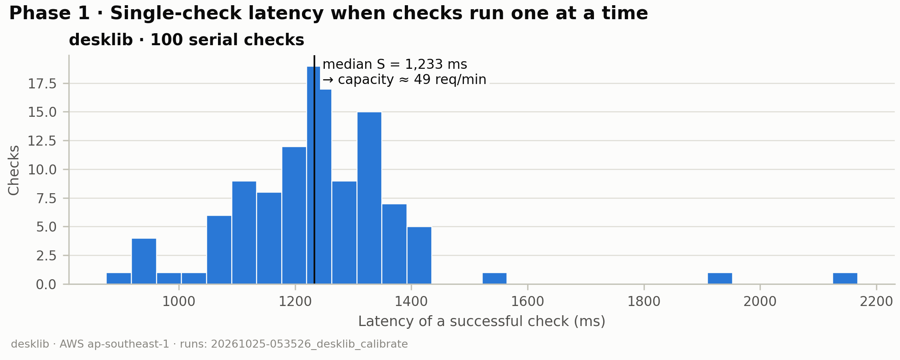
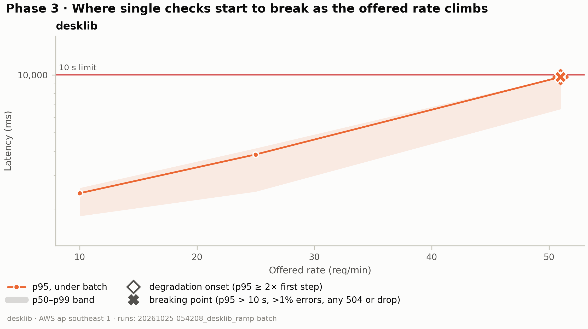
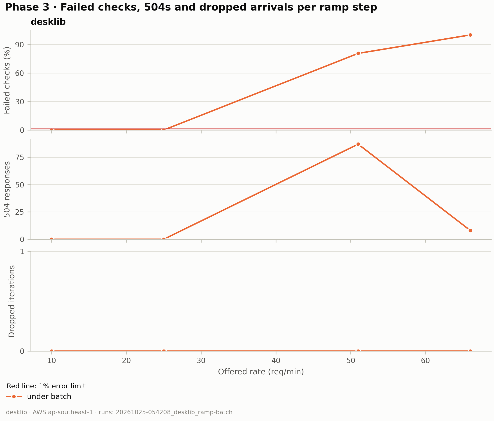
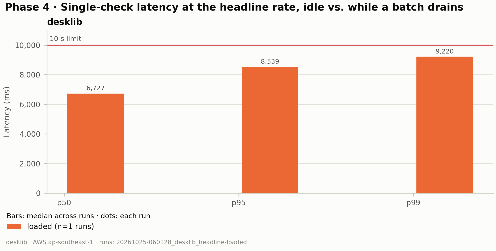
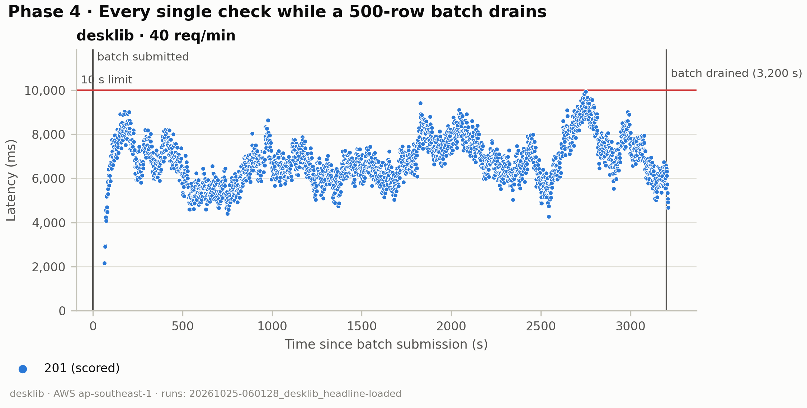
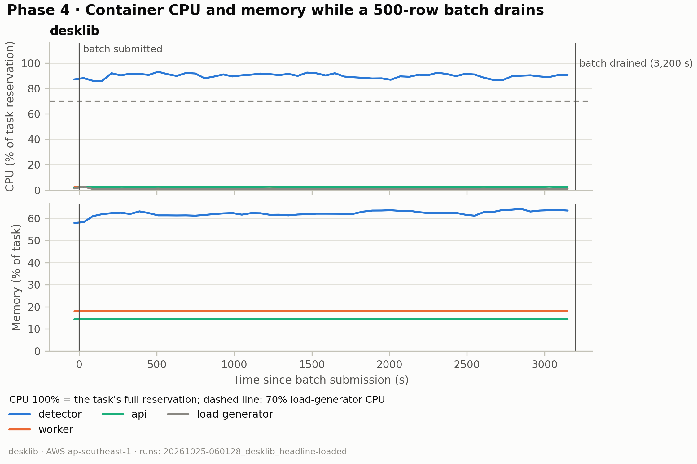

# PP-533 load test — results

_Generated by `render.py` from `results/`. Edit only inside `<!-- hand:… -->` blocks; everything else is rewritten on every render (`run.sh render`)._

## Method

- **Stack.** The deployed AWS stack: CloudFront, then WAF (the load generator's Elastic IP is
  exempted from the rate rules), then a VPC origin to the internal ALB, then one Fargate task per
  service (api, worker, detector), with RDS Postgres and SQS/S3 behind them. Requests authenticate
  with a real session cookie, so the measured path is the production path minus Auth0.
- **Task sizes** (from `meta.json`): api 0.5 vCPU / 1024 MiB; worker 0.25 vCPU / 512 MiB; detector 1 vCPU / 4096 MiB.
- **Load generator:** an EC2 t3.small instance in ap-southeast-1
  (same Region as the stack), running k6 v2.3.0 with an open
  workload model (arrival-rate executors), so a slow server cannot slow the arrivals down.
- **Code under test:** git 0ca0f61.
- **Workload.** `POST /api/checks` with a random short answer (strictness `standard`). Each run
  starts with 20 serial warm-up checks that are excluded from every number. Latency figures use
  successful checks only (201 with a verdict) so a fast error never looks like good latency;
  failures count in the error rate. Phases: 1 calibrate (100 serial checks, S = median),
  3 stepped ramp at 0.1–1.25 × 60/S req/min (2 min plateaus, idle and under 500-row batches),
  4 headline constant rate (idle 10 min; loaded until one 500-row batch drains), 5–6 batch
  submission freeze before/after the `create_batch` fix.

## Prediction (Phase 2)

<!-- hand:prediction -->
_This report covers Phase 9 (2026-10-25): the detector at 1 vCPU / 4 GB with
`DETECTOR_TORCH_THREADS=1` (task-def rev 27), on an Intel Xeon Platinum 8259CL. The control is
rev 28, 2 vCPU / 1 thread on the same CPU model, calibrate only (`results/_phase9-control/`).
Earlier reports: `../RESULTS.md` (first AC4) and `../report-phase7-8/RESULTS.md`._

**Prediction (EXPERIMENT_LOG Entry 7, written while calibrate ran).** S ~0.8–1.0 s,
under-batch break ~60–75/min, loaded p95 at 40/min ~2–3 s, and the control within ~5% of the
1 vCPU S. Cut to 1 vCPU only if its S is within 10% of the control's and AC4 passes at 40.

**Found before any run.**

- A 1 vCPU task sees 2 CPUs. Rev 26 logged `intra-op 2, CPUs available 2`: Fargate enforces the
  1 vCPU as a quota, and `process_cpu_count` ignores it, so torch ran two threads in one vCPU.
  Rev 27 pins one thread. Any 1 vCPU detector must ship with `detector_torch_threads = 1`.
- 1 vCPU tasks landed on older CPUs: 7 redeploys gave one 8175M and six 8259CL, never the
  6975P-C of Phases 7–8. So the 1 vCPU run and the control both use an 8259CL.

### 1 vCPU vs 2 vCPU, same CPU model (8259CL), one torch thread each

| Measure | 1 vCPU (rev 27) | 2 vCPU control (rev 28) |
|---|---|---|
| S (calibrate median) | 1.233 s | 0.779 s |
| Calibrate p95 | 1,418 ms | 889 ms |
| Detector CPU peak (calibrate) | 89% of 1 vCPU | 49% of 2 vCPU |
| Detector memory peak (calibrate) | 50% of 4 GB | 50% of 4 GB |

**The prediction was wrong.** S was 1.233 s, not 0.8–1.0 s, and the control was 37% faster
(1 vCPU is 58% slower). By the rule set in advance, 1 vCPU is rejected.
<!-- /hand:prediction -->

## Results

### Phase 1 — calibration

| Model | Run | OK checks | p50 ms | p95 ms | p99 ms | S (s, from k6) | Capacity 60/S (req/min) |
|---|---|---|---|---|---|---|---|
| desklib | `20261025-053526_desklib_calibrate` | 100 | 1,233 | 1,418 | 1,929 | 1.233 | 49 |

### Phase 3 — stepped ramp

_Achieved req/min is completion throughput (k6 stamps each request when it completes), not the arrival rate: under overload it falls below the offered rate._

**desklib, under batch** (`20261025-054208_desklib_ramp-batch`): onset 51 req/min, breaking point 51 req/min.

| Offered req/min | Achieved req/min (completions) | p50 ms | p95 ms | p99 ms | Errors | 504 | Dropped | Marker |
|---|---|---|---|---|---|---|---|---|
| 10 | 10.1 | 1,832 | 2,413 | 2,570 | 0.0% | 0 | 0 |  |
| 25 | 24.4 | 2,458 | 3,845 | 4,139 | 0.0% | 0 | 0 |  |
| 51 | 47.5 | 6,631 | 9,765 | 9,808 | 80.6% | 87 | 0 | onset **breaking** |
| 66 | 56.7 | — | — | — | 100.0% | 8 | 0 |  |

### Phase 4 rate choice

<!-- hand:rate-choice -->
R = 40/min, the same as every earlier AC4 run, so the setups compare directly. At 1 vCPU,
40/min is 78% of the under-batch break (51), not the 60% we chose R for. Only one loaded run
fit in this sitting; it was enough to answer the question.

**Against earlier setups (under batch, R = 40 loaded):**

| | First AC4 | Phase 8 | Phase 9 |
|---|---|---|---|
| vCPU / torch threads | 2 / default | 2 / 2 | 1 / 1 |
| CPU | not logged | 6975P-C | 8259CL |
| S | 0.909 s | 0.589 s | 1.233 s |
| Under-batch onset / break | 53 / 66 per min | 81 / 102 per min | 51 / 51 per min |
| Loaded p95 at 40 | 2,661 ms | 1,150 ms | 8,539 ms |
| 500-row batch drain | ~1,016 s | 455 s | 3,199 s |

Phase 9's ramp used `--service-time 0.589`, so its steps match Phase 8's (10, 25, 51, 66 …).
The break lies between 25/min (p95 3.8 s, 0 errors) and 51/min; there is no step in between.
<!-- /hand:rate-choice -->

### Phase 4 — headline

Percentiles and error rate: median across runs. 504s and dropped: totals across runs.

| Model | Condition | Runs | Rate (req/min) | p50 ms | p95 ms | p99 ms | Errors | 504 | Dropped | Batch drain (s) |
|---|---|---|---|---|---|---|---|---|---|---|
| desklib | loaded | 1 | 40 | 6,727 | 8,539 | 9,220 | 0.0% | 0 | 0 | 3,200 |

### Phases 5–6 — `create_batch` freeze

_Figure 7 (create_batch freeze, before vs. after fix): not yet run._

### Model comparison

_Figure 8 (model comparison): needs charted runs of both models; not yet run._

## Discussion

<!-- hand:discussion -->
**The second vCPU matters, even though a second torch thread doesn't.** On the same 8259CL, S
was 1.233 s on 1 vCPU and 0.779 s on 2 vCPU with one thread each. In Phase 7 a second thread
only competed with the first for one core. Here the single vCPU's quota has to cover inference
and everything else in the process (uvicorn, the tokenizer), and detector CPU sat at 89% even
during serial calibrate. That is the likely reason; it isn't proven.

**The CPU generation matters too.** The same 2 vCPU / 1 thread setup took 0.779 s on the 8259CL
against 0.591 s on the 6975P-C (Phase 7 arm A), 32% slower. The first AC4 ran at 0.909 s on a
CPU we didn't log, so slower hosts than the 8259CL exist.

**Fargate doesn't let us pick the CPU.** `cpu_architecture` only chooses X86_64 or ARM64. In our
tries, 1 vCPU tasks only landed on older CPUs (8175M, 8259CL); 2 vCPU tasks got the 6975P-C,
8488C and 8259CL. That's a small sample, but cutting to 1 vCPU may also cost the fast hosts.

**Overload shows up as 504s again.** At 51/min, 87 checks timed out. This fits the DB-pool
hypothesis from Phase 8: about 15 checks wait for a connection, and 15 × 1.23 s ≈ 18 s is past
the 10 s budget (at 0.59 s it was ~9 s, so Phase 8 saw no 504s). Still unconfirmed.

**Cost.** 1 vCPU would save ~$36/month, but halves capacity on the same CPU and leaves R = 40
at 78% of the break, with a 53-minute batch drain. Not worth it.
<!-- /hand:discussion -->

## AC4 verdict

Thresholds: p95 < 10,000 ms (median of runs), 504 = 0, check success > 99% (pooled), dropped iterations = 0 (totals across runs).

| Model | Condition | Runs | p95 ms | 504 | Check success | Dropped |
|---|---|---|---|---|---|---|
| desklib | loaded | 1 | 8,539 PASS | 0 PASS | 100.0% PASS | 0 PASS |

<!-- hand:verdict -->
**1 vCPU: technically PASS at R = 40** (p95 8.54 s, 0 504s, 100% success, 0 dropped, 1 run),
but only 1.5 s under the limit, at 78% of the under-batch break, and a batch takes 53 minutes
to drain. **Rejected** by the rule set in advance: S was 58% slower than the 2 vCPU control on
the same CPU.

**Decision: keep the detector at 2 vCPU / 4 GB with `detector_torch_threads = 1`.** Rev 28 is
live with that setup now.
<!-- /hand:verdict -->

## Limitations

- **1-minute metric resolution.** CloudWatch / Container Insights points are one per minute, so
  short spikes in CPU and memory are averaged away.
- **One task per service, no autoscaling.** api, worker and detector each run a single Fargate
  task; the results describe that fixed size, not what scaling out would give.
- **No last-mile client latency.** The load generator sits in the same Region as the stack, so
  numbers exclude the network between an instructor's browser and CloudFront.
- **Short-answer workload.** Answers come from the project's short-answer corpus. Longer
  answers cost the detector more per check, so capacity for long answers will be lower.
- **Campus-shared IP vs. WAF rate limit.** `rate-writes` is per IP. Instructors on the campus
  network probably share one public IP, so together they get ~1 write/s (checks, batch submits,
  user admin) before WAF returns 403. At current usage this is likely fine, but it is a real
  production limit. The load generator is exempted from the rule, so these runs do not show it.

## Runs not charted

_None._

## Excluded runs

_None._
