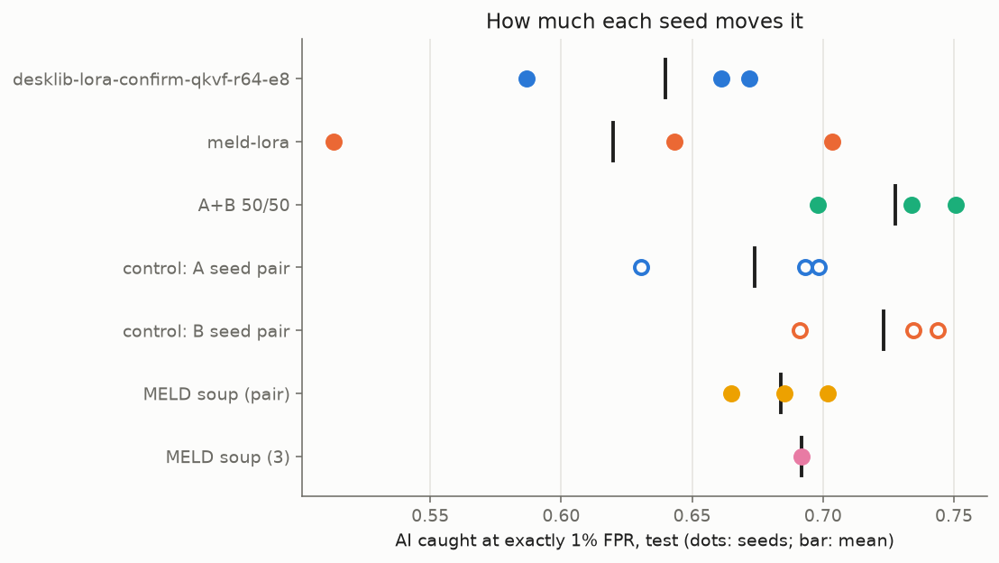
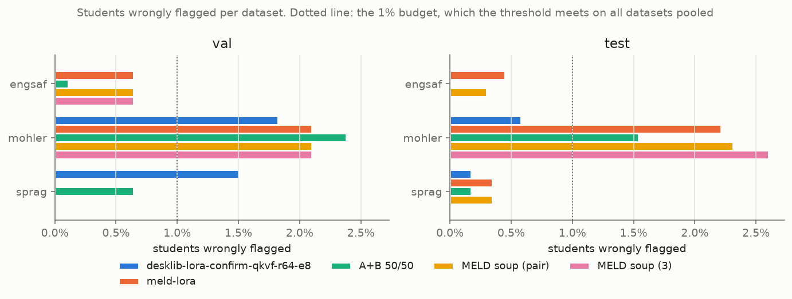
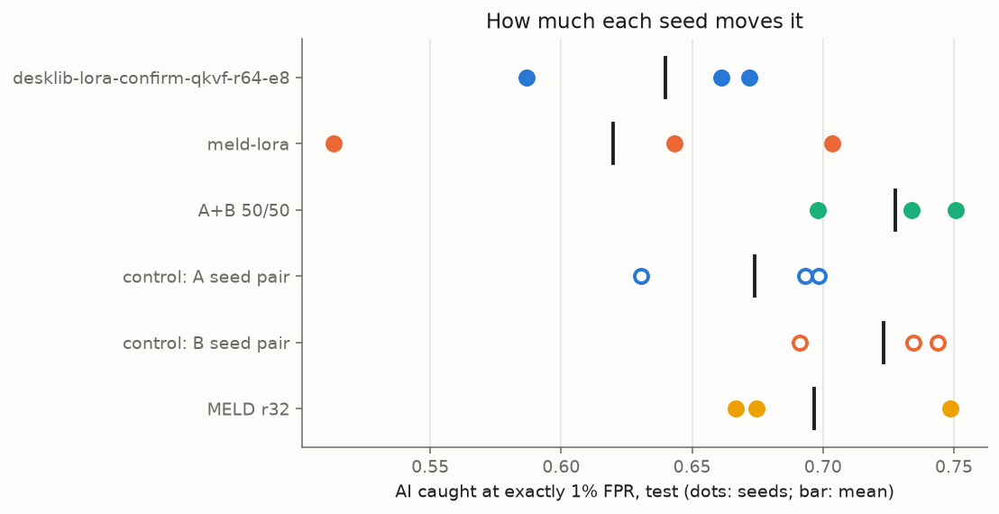
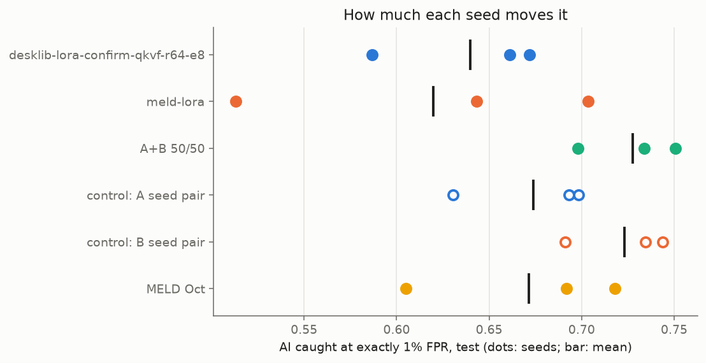
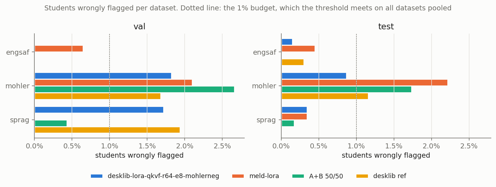
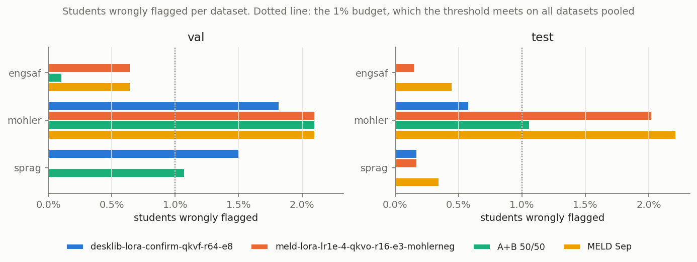
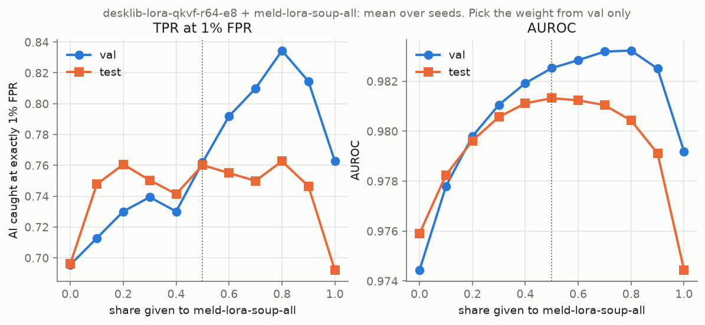

# desklib + MELD: experiment results

Results of the experiments planned in [desklib-meld-experiment-plan.md](desklib-meld-experiment-plan.md), one
section per experiment, in the order they ran. Same protocol throughout:
- extended corpus `v0.1-extended`, answers of 10+ words only;
- threshold fitted on val at 1% FPR and frozen;
- intervals are 95% paired cluster bootstraps on test that resample whole questions (1,000 draws).

Every table and figure is regenerated by the commands in each section's "Analysis" line, run from `ml-training/`.
Their outputs go to `ml-training/outputs/analysis/<experiment>/`, which git ignores, so this file is the record.
`compare.csv` in each folder holds the paired "new minus old" tables, including per-dataset false-flag rates.

"AI caught at 1% FPR" is the oracle TPR at exactly 1% FPR on test. "Deployed" uses the frozen val threshold, so its
FPR can drift from 1%.

## E1: MELD soups (1 Nov 2026)

**Question.** Averaging two MELD seeds' scores gave the biggest jump so far (62.0% → 72.3% AI caught at 1% FPR).
Can one MELD model, built by averaging the seeds' *weights*, give the same at one model's inference cost?

**What ran.** `soup_meld_lora.py` via `cluster/meld_soup.sh`. No training. It took the adapter and prototype head
of `meld-lora-extended-s1/s2/s3`, averaged the merged LoRA updates (scale·B·A) and the heads, and scored val and
test. It built:
- three pair soups, `meld-lora-soup-pair-s{1,2,3}` (seed s with seed s+1, the same pairs as the score-average
  control);
- one 3-seed soup, `meld-lora-soup-all-s1`.

Before building, the job rebuilt seed 1 alone and checked it reproduced that run's saved val scores. The soups
only run if that check passes, so it passed. The four soups took 15 minutes in total on an RTX 3090.

Analysis: `analyse_ensemble.py --extra "MELD soup (pair)=meld-lora-soup-pair" --extra "MELD soup (3)=meld-lora-soup-all@1"`,
plus a direct paired comparison of each soup with the score average of the same seeds.

### Results

| Test, answers of 10+ words | Models at inference | Val AUROC | Test AUROC | AI caught at 1% FPR (sd over seeds) | Deployed TPR / FPR |
| --- | --- | --- | --- | --- | --- |
| MELD, 1 seed | 1 | 0.976 | 0.971 | 62.0% (9.7) | 65.3% / 1.22% |
| MELD, 2 seeds, scores averaged | 2 | 0.979 | 0.975 | **72.3%** (2.8) | 70.6% / 0.83% |
| **MELD pair soup** | **1** | 0.979 | 0.974 | **68.4%** (1.8) | 70.4% / 1.22% |
| MELD, 3 seeds, scores averaged | 3 | 0.980 | 0.977 | 73.1% | 73.0% / 0.92% |
| MELD 3-seed soup | 1 | 0.979 | 0.974 | 69.2% | 70.3% / 1.18% |
| desklib + MELD 1 seed (current best) | 2 | 0.980 | 0.978 | 72.7% (2.7) | 70.2% / 0.74% |
| desklib + MELD pair soup | 2 | 0.980 | 0.978 | 72.4% (1.1) | 68.1% / 0.57% |
| desklib + MELD 3-seed soup | 2 | 0.981 | 0.979 | 72.4% (1.3) | 68.5% / 0.52% |
| desklib + 3 MELD seeds averaged | 4 | 0.981 | 0.979 | 72.5% (0.7) | 70.1% / 0.74% |

Paired differences on test (first minus second):

| Comparison | AUROC | AI caught at 1% FPR | Deployed TPR |
| --- | --- | --- | --- |
| pair soup − 2 seeds' scores averaged | −0.0016 [−0.0033, +0.0001] | −3.9 pts [−7.6, +2.0] | −0.2 pts [−1.1, +0.7] |
| pair soup − 1 seed | **+0.0026** [+0.0010, +0.0044] | +6.4 pts [−0.8, +9.5] | **+5.1 pts** [+3.6, +6.4] |
| 3-seed soup − 3 seeds' scores averaged | **−0.0022** [−0.0043, −0.0002] | −3.9 pts [−9.8, +1.3] | **−2.8 pts** [−4.3, −1.0] |
| desklib + pair soup − desklib + MELD 1 seed | +0.0005 [−0.0001, +0.0012] | −0.3 pts [−2.1, +2.4] | **−2.1 pts** [−2.7, −1.4] |

Bold: the interval excludes 0.

### Findings

1. **A soup is a better single MELD model, and it removes the seed lottery.**
   - Against one seed, the pair soup gains +0.0026 AUROC and +5.1 pts deployed TPR, both clear of noise.
   - At exactly 1% FPR it gains +6.4 pts, but that interval [−0.8, +9.5] just includes 0.
   - The spread over seeds falls from sd 9.7 to 1.8 pts. The worst soup (66.5%) is better than two of the three
     single seeds (51.3% and 64.3%).
   - It costs one model at inference, the same as a single seed.
2. **The soup recovers about 60% of what score averaging gives, not all of it.**
   - At 1% FPR, the soup is at 68.4% against 72.3% for the score average. The −3.9 pt gap is within noise, but the
     point estimate is consistently negative: 3 of 3 pairs, and the 3-seed soup too.
   - The loss is in the false flags. The soup's deployed TPR matches the score average (70.4% vs 70.6%), but at
     1.22% FPR instead of 0.83%.
   - All of the extra false flags are Mohler students: 2.3% of them on test, the same as a single seed. Averaging
     two seeds' scores had lowered that to 1.7%.
   - Ranking on test confirms the picture. The soup ranks answers closer to the score average than to either
     member. Spearman with the score average is 0.97–0.99 on human answers, but only 0.85–0.94 on AI answers.
3. **Inside desklib + MELD, the soup adds nothing.**
   - desklib + soup: 72.4% vs 72.7%, a difference of −0.3 pts [−2.1, +2.4].
   - Even averaging three MELD seeds' scores into the pair gives 72.5%. Once desklib is in the average, MELD's seed
     noise is already absorbed.
   - The soup does make the pair steadier across seeds (sd 2.7 → 1.1).
   - With the soup, the frozen threshold lands slightly higher, so the pair flags less: deployed 68.1% / 0.57%
     instead of 70.2% / 0.74%.
4. **Against the decision rule set before the run:**
   - The rule: the soup must be within noise of the score-average control (72.3%) *and* clearly above a single seed
     (62.0%).
   - The first part holds.
   - The second holds on AUROC and deployed TPR, but not at exactly 1% FPR, where the interval just includes 0.
   - **Verdict: partial success.**

### What it means

- **If MELD ships on its own, ship the pair soup or the 3-seed soup, not a single seed.** It is the same cost and
  much less dependent on which seed was drawn.
- **For desklib + MELD, the gains must come from better models (E2–E5), not from more averaging of MELD.** Either
  MELD form can go in the pair. The soup is the steadier choice; the single seed flags slightly more at the frozen
  threshold.
- **Mohler's false flags survive every form of averaging tried.** That is the case for E4, which weights Mohler's
  human answers in training.
- **Any new 3-seed MELD setting can be souped in about 15 minutes:** `BASE=<run-name base> sbatch cluster/meld_soup.sh`.

## E2: MELD at LoRA rank 32 (1 Nov 2026)

**Question.** The extended MELD runs used rank 16, the script's default. Rank 32 had won MELD's stage-2 sweep on
the old corpus (val AUROC 0.965 vs 0.961, 2 seeds), but that result was never carried over. Is rank 32 better on the
extended corpus?

**What ran.**
- `meld-lora-lr1e-4-qkvo-r32-e3-extended-s{1,2,3}`: the same recipe as `meld-lora-extended` (LoRA on Wqkv and Wo,
  lr 1e-4, 3 epochs, dropout 0.05, Sep release) with rank 32 and alpha 64 instead of rank 16 and alpha 32.
- 3 seeds in one job, about 15 minutes per seed.

**Decision rule, set before the run:** adopt rank 32 only if its mean val AUROC over 3 seeds beats rank 16's (0.976).

### Results

| Answers of 10+ words | Val AUROC | Val AI caught at 1% FPR (sd) | Test AUROC | Test AI caught at 1% FPR (sd) | Deployed TPR / FPR |
| --- | --- | --- | --- | --- | --- |
| MELD rank 16 (`meld-lora-extended`) | **0.976** | 70.2% (8.7) | 0.971 | 62.0% (9.7) | 65.3% / 1.22% |
| MELD rank 32 | 0.974 | 72.7% (3.0) | 0.969 | 69.7% (4.5) | 69.4% / 1.01% |
| rank 16, 2 seeds' scores averaged | 0.979 | 75.8% | 0.975 | 72.3% (2.8) | 70.6% / 0.83% |
| rank 32, 2 seeds' scores averaged | 0.978 | 75.2% | 0.973 | 71.0% (1.8) | 71.0% / 1.01% |
| desklib + MELD rank 16 (current best) | **0.980** | 76.2% | 0.978 | 72.7% (2.7) | 70.2% / 0.74% |
| desklib + MELD rank 32 | 0.979 | 71.8% | 0.977 | 71.5% (2.3) | 67.1% / 0.57% |

Paired differences, rank 32 minus rank 16 (`compare_runs.py --new meld-lora-lr1e-4-qkvo-r32-e3-extended --old
meld-lora-extended --partner desklib-lora-confirm-qkvf-r64-e8 --out outputs/analysis/E2`):

| Comparison | Val AUROC | Val AI caught at 1% FPR | Test AUROC | Test AI caught at 1% FPR | Test deployed TPR |
| --- | --- | --- | --- | --- | --- |
| single model | −0.0017 [−0.0062, +0.0017] | +2.5 pts [−3.6, +10.3] | −0.0022 [−0.0072, +0.0024] | +7.7 pts [−0.3, +12.3] | **+4.1 pts** [+2.6, +5.8] |
| 2 seeds' scores averaged | −0.0008 [−0.0047, +0.0020] | −0.6 pts [−6.4, +4.1] | −0.0023 [−0.0056, +0.0007] | −1.4 pts [−5.1, +6.5] | +0.5 pts [−0.9, +2.1] |
| inside desklib + MELD | **−0.0013** [−0.0032, −0.0001] | −4.4 pts [−10.0, +1.1] | **−0.0012** [−0.0023, −0.0001] | −1.3 pts [−4.2, +3.0] | **−3.1 pts** [−4.1, −2.2] |

Bold: the interval excludes 0.

### Findings

1. **Rank 32 is not adopted.** Its mean val AUROC is 0.974, below rank 16's 0.976, so it fails the rule set before
   the run. Its AUROC is lower on test too, though within noise.
2. **The single rank-32 model looks better at 1% FPR, but that is seed spread, not a better model.**
   - Alone, rank 32 catches +7.7 pts more AI on test at 1% FPR (the interval just includes 0), and its seeds vary
     less (sd 4.5 vs 9.7).
   - Rank 16's mean is pulled down by one bad seed (seed 3, 51%). Once seed noise is averaged out, the advantage
     disappears: averaging two seeds gives −1.4 pts, and inside desklib + MELD −1.3 pts.
   - So rank 32 mainly gives a steadier single model, which E1's soup already does at rank 16.
3. **Inside the detector, rank 32 is slightly worse.**
   - desklib + MELD rank 32 is lower on AUROC on both val and test, with both intervals clear of 0.
   - It catches 3.1 pts fewer AI at the frozen threshold, at a lower FPR (0.57% vs 0.74%).
4. **The stage-2 result did not carry over to the extended corpus.** Old corpus: rank 32 led by +0.005 val AUROC
   on 2 seeds. Extended corpus: −0.002 on 3 seeds.
5. **Mohler's false flags are unchanged**: 1.8% of Mohler students on test, against 2.2% at rank 16.

**Decision:** MELD stays at rank 16 (`meld-lora-extended`). Rank 32 is not souped.

**Housekeeping:** DagsHub has a second, empty `meld-lora-lr1e-4-qkvo-r32-e3-extended-s3` run (`9ed6c270…`) stuck in
RUNNING, with no metrics or files. It looks like a retried run creation. The analysis used the finished run
(`592c9d2f…`). The empty run can be deleted.

## E3: MELD on the Oct release (3 Nov 2026)

**Question.** One MELD seed trained on the Oct release of the base model (`ddfc9c78`) was +4.9 pts at 1% FPR over
the Sep release. Does that hold over 3 seeds?

**What ran.**
- Seeds 2 and 3 of `meld-lora-sw-lr1e-4-qkvo-r16-e3-revddfc9c78-extended`, added to the existing seed 1 (31 Oct).
  Same recipe as `meld-lora-extended` (rank 16, LoRA on Wqkv and Wo, lr 1e-4, 3 epochs, dropout 0.05); only the
  release differs.
- About 30 minutes per seed.

**Decision rule, set before the run:** adopt the Oct release only if its mean val AUROC over 3 seeds beats the Sep
release's (0.976).

Analysis: `analyse_ensemble.py --extra "MELD Oct=…revddfc9c78-extended" --out outputs/analysis/E3`, the same with
`--b …revddfc9c78-extended --out outputs/analysis/E3-pair` for the Oct rows inside desklib + MELD, and
`compare_runs.py --new …revddfc9c78-extended --old meld-lora-extended --partner desklib-lora-confirm-qkvf-r64-e8
--out outputs/analysis/E3` for the paired tables.

### Results

| Answers of 10+ words | Val AUROC | Val AI caught at 1% FPR (sd) | Test AUROC | Test AI caught at 1% FPR (sd) | Deployed TPR / FPR |
| --- | --- | --- | --- | --- | --- |
| MELD Sep (`meld-lora-extended`) | 0.9755 | 70.2% (8.7) | 0.971 | 62.0% (9.7) | 65.3% / 1.22% |
| MELD Oct | **0.9769** | 73.4% (2.9) | 0.973 | 67.2% (5.9) | 68.5% / 1.09% |
| Sep, 2 seeds' scores averaged | 0.979 | 75.8% | 0.975 | 72.3% (2.8) | 70.6% / 0.83% |
| Oct, 2 seeds' scores averaged | 0.980 | 78.9% | 0.976 | 75.4% (0.4) | 73.6% / 0.83% |
| desklib + MELD Sep (current best) | 0.980 | 76.2% | 0.978 | 72.7% (2.7) | 70.2% / 0.74% |
| desklib + MELD Oct | 0.980 | 73.8% | 0.979 | **74.1%** (0.6) | 68.1% / 0.35% |

Paired differences, Oct minus Sep:

| Comparison | Val AUROC | Val AI caught at 1% FPR | Test AUROC | Test AI caught at 1% FPR | Test deployed TPR |
| --- | --- | --- | --- | --- | --- |
| single model | +0.0013 [−0.0027, +0.0057] | +3.2 pts [−5.2, +14.6] | +0.0020 [−0.0027, +0.0076] | +5.2 pts [−9.1, +13.1] | **+3.2 pts** [+1.0, +5.7] |
| 2 seeds' scores averaged | +0.0009 [−0.0030, +0.0047] | +3.0 pts [−2.0, +9.0] | +0.0010 [−0.0032, +0.0059] | +3.1 pts [−8.3, +9.4] | **+3.0 pts** [+0.6, +5.7] |
| inside desklib + MELD | −0.0001 [−0.0026, +0.0017] | −2.4 pts [−4.8, +6.8] | +0.0012 [−0.0005, +0.0034] | +1.3 pts [−3.7, +7.1] | **−2.1 pts** [−3.0, −1.1] |

Students wrongly flagged, Oct minus Sep (only the intervals that exclude 0, or nearly):

| Comparison | Mohler, val | Mohler, test | SPRAG, val |
| --- | --- | --- | --- |
| single model | **1.26% vs 2.10%** [−1.8, −0.1 pts] | 1.83% vs 2.22% [−1.8, +1.1] | 1.72% vs 0.00% [0.0, +3.7] |
| inside desklib + MELD | 2.10% vs 2.38% [−1.0, +0.3] | **0.58% vs 1.54%** [−1.9, −0.1 pts] | 1.08% vs 0.65% [−0.9, +1.5] |

Bold: the interval excludes 0.

### Findings

1. **The Oct release meets the rule, but only just.** Its mean val AUROC is 0.9769 against 0.9755. The paired gap,
   +0.0013 [−0.0027, +0.0057], is well inside noise. The seed-1 result that prompted E3 (+4.9 pts) shrinks to
   +3.2 pts on val and +5.2 pts on test, neither clear of noise.
2. **Alone, the Oct model is a steadier and slightly better MELD.**
   - Its seeds vary less: sd 5.9 pts at 1% FPR on test, against 9.7. Its worst seed (60.5%) beats Sep's worst
     (51.3%).
   - At the frozen threshold it catches +3.2 pts more AI, clear of noise, at a slightly lower FPR (1.09% vs 1.22%).
   - It flags fewer Mohler students on val (1.26% vs 2.10%, clear of noise), but 1.7% of SPRAG students against
     none. On val that is 3 of 155 students, so it is a shift in who gets flagged rather than fewer flags overall.
3. **Inside the detector, Oct gives a steadier pair that flags fewer students.**
   - desklib + MELD Oct: 74.1% at 1% FPR on test, with seeds within 0.6 pts of each other, against 72.7% (sd 2.7).
     The +1.3 pt gap is within noise, and on val it is −2.4 pts, also within noise.
   - At the frozen threshold the pair flags fewer of everyone: 68.1% / 0.35% instead of 70.2% / 0.74%. Mohler
     students wrongly flagged on test fall from 1.54% to 0.58%, clear of noise.

**Decision:** by the rule as written, the Oct release is adopted as the MELD reference. The val margin is within
noise, so the case rests as much on the steadier seeds and the lower false-flag rate as on AUROC. If MELD ships
on its own, the Oct runs can be souped like E1:
`BASE=meld-lora-sw-lr1e-4-qkvo-r16-e3-revddfc9c78-extended sbatch cluster/meld_soup.sh`.

**Update (4 Nov):** a second set of Oct runs (the new MELD baseline below) landed at val AUROC 0.9749, below Sep.
The release choice is a tie, and E7 picks the MELD runs on val.

## desklib reference rerun (3 Nov 2026)

**Why.** E4a and E5a are compared against `desklib_experiment.sh` with no weights. That job has the same recipe
as `desklib-lora-confirm-qkvf-r64-e8`, but it also logs training curves and the adapter. Run as
`desklib-lora-qkvf-r64-e8-extended-s{1,2,3}`, 12 minutes per seed.

Analysis: `analyse_ensemble.py --a desklib-lora-qkvf-r64-e8-extended --out outputs/analysis/desklib-ref`.

| Answers of 10+ words | Val AUROC | Val AI caught at 1% FPR (sd) | Test AUROC | Test AI caught at 1% FPR (sd) | Deployed TPR / FPR |
| --- | --- | --- | --- | --- | --- |
| desklib confirm runs (`desklib-lora-confirm-qkvf-r64-e8`) | 0.969 | 59.3% (9.7) | 0.970 | 64.0% (4.6) | 55.6% / 0.31% |
| desklib reference rerun | 0.972 | 64.5% (10.5) | 0.971 | 64.9% (7.4) | 58.2% / 0.61% |
| desklib confirm + MELD Sep | 0.980 | 76.2% | 0.978 | 72.7% (2.7) | 70.2% / 0.74% |
| desklib rerun + MELD Sep | 0.981 | 73.9% | 0.979 | 72.9% (2.2) | 68.2% / 0.48% |

**Finding:** the rerun reproduces the confirm runs within seed noise, alone and inside desklib + MELD. It is the
control for E4a and E5a. Earlier sections keep the confirm runs, so their numbers are unchanged.

## E4: Mohler's human answers weighted double (3 Nov 2026)

**Question.** Mohler students are the ones wrongly flagged most often (about 2% on test for MELD, against a 1%
budget). Do fewer get flagged if their answers count double in training?

**What ran.**
- `--weights 'dataset=mohler&slice=human:2'`. Each class's weights are rescaled to average 1, so Mohler's humans
  get 1.31 and SPRAG's and EngSAF's humans 0.66; the AI answers are unchanged.
- E4a: `desklib-lora-qkvf-r64-e8-mohlerneg-extended-s{1,2,3}`, against the desklib reference rerun.
- E4b: `meld-lora-lr1e-4-qkvo-r16-e3-mohlerneg-extended-s{1,2,3}`, against `meld-lora-extended` (Sep release, the
  same recipe without weights).
- About 12 minutes per desklib seed and 28 per MELD seed.

**Decision rule, set before the run:** success is a lower Mohler false-flag rate on val, with AI caught at 1% FPR
down by at most ~2 pts.

Analysis: `analyse_ensemble.py` into `outputs/analysis/E4a`, `E4b` (each with the unweighted model as `--extra`)
and `E4-both` (both models weighted), plus `compare_runs.py` for each weighted model against its control (E4a:
`--old desklib-lora-qkvf-r64-e8-extended --partner meld-lora-extended`; E4b: `--old meld-lora-extended --partner
desklib-lora-confirm-qkvf-r64-e8`), which writes `compare.csv` into the same folders.

### Results

| Answers of 10+ words | Val AUROC | Val AI caught at 1% FPR (sd) | Test AUROC | Test AI caught at 1% FPR (sd) | Deployed TPR / FPR | Mohler wrongly flagged, val / test |
| --- | --- | --- | --- | --- | --- | --- |
| desklib (reference rerun) | 0.972 | 64.5% (10.5) | 0.971 | 64.9% (7.4) | 58.2% / 0.61% | 1.68% / 1.16% |
| desklib, Mohler ×2 (E4a) | 0.972 | 59.2% (4.0) | 0.968 | 61.8% (0.7) | 55.9% / 0.52% | 1.82% / 0.87% |
| MELD Sep | 0.976 | 70.2% (8.7) | 0.971 | 62.0% (9.7) | 65.3% / 1.22% | 2.10% / 2.22% |
| MELD, Mohler ×2 (E4b) | 0.969 | 53.8% (33.7) | 0.969 | 57.3% (12.5) | 49.4% / 1.01% | 2.10% / 2.02% |
| desklib rerun + MELD Sep | 0.981 | 73.9% | 0.979 | 72.9% (2.2) | 68.2% / 0.48% | 2.24% / 1.06% |
| desklib ×2 + MELD Sep | 0.981 | 74.7% | 0.977 | 72.0% (3.1) | 69.0% / 0.83% | 2.66% / 1.73% |
| desklib confirm + MELD Sep (current best) | 0.980 | 76.2% | 0.978 | 72.7% (2.7) | 70.2% / 0.74% | 2.38% / 1.54% |
| desklib confirm + MELD ×2 | 0.979 | 72.6% | 0.977 | 71.7% (1.3) | 67.0% / 0.48% | 2.10% / 1.06% |
| both ×2 | 0.980 | 73.2% | 0.976 | 69.3% (5.5) | 66.8% / 0.83% | 2.38% / 1.73% |

Paired differences, weighted minus unweighted:

| Comparison | Val AUROC | Val AI caught at 1% FPR | Val Mohler wrongly flagged | Test AUROC | Test AI caught at 1% FPR | Test Mohler wrongly flagged |
| --- | --- | --- | --- | --- | --- | --- |
| desklib alone | −0.0001 [−0.0028, +0.0033] | −5.3 pts [−13.6, +11.4] | +0.1 pts [−1.2, +1.5] | **−0.0036** [−0.0070, −0.0002] | −3.1 pts [−8.7, +6.3] | −0.3 pts [−1.1, +0.3] |
| desklib, inside desklib + MELD | +0.0002 [−0.0009, +0.0018] | +0.8 pts [−6.7, +4.3] | +0.4 pts [−0.8, +1.6] | **−0.0020** [−0.0040, −0.0000] | −0.9 pts [−5.7, +3.0] | **+0.7 pts** [+0.2, +1.3] |
| MELD alone | **−0.0070** [−0.0111, −0.0035] | **−16.4 pts** [−20.7, −6.5] | 0.0 pts [−1.1, +1.5] | −0.0025 [−0.0074, +0.0019] | −4.7 pts [−16.1, +4.1] | −0.2 pts [−1.1, +0.7] |
| MELD, 2 seeds' scores averaged | −0.0024 [−0.0052, +0.0001] | −3.0 pts [−7.6, +3.4] | −0.1 pts [−1.0, +0.8] | −0.0014 [−0.0047, +0.0017] | −3.5 pts [−8.2, +2.7] | +0.2 pts [−0.5, +1.0] |
| MELD, inside desklib + MELD | **−0.0013** [−0.0029, −0.0001] | −3.6 pts [−7.3, +1.9] | −0.3 pts [−0.9, +0.6] | −0.0008 [−0.0018, +0.0003] | −1.0 pts [−4.2, +2.5] | −0.5 pts [−1.1, +0.1] |

Bold: the interval excludes 0. Each model's flags use its own frozen val threshold.

### Findings

1. **E4 fails for both models: weighting Mohler's humans does not lower Mohler's val false-flag rate.**
   - desklib: 1.82% against 1.68%. MELD: 2.10% against 2.10%. Inside desklib + MELD, neither form moves it
     clear of noise.
   - On test, the desklib-weighted pair flags *more* Mohler students (1.73% vs 1.06%), the only gap clear of noise.
   - The weighted models also catch less AI: −5.3 pts for desklib and −16.4 pts for MELD on val.
2. **MELD seed 3 broke because of how its epoch was chosen, not because training failed.**
   - Its val AUROC was flat over the 3 epochs (0.9453, 0.9454, 0.9457), so `SELECT=auroc` took the last one. By
     then its val TPR at 1% FPR had fallen from 69.8% at epoch 1 to 15.0%.
   - That one seed causes most of MELD's −16.4 pts. Averaged over two seeds, the loss is −3.0 pts, within noise.
   - Even without it, Mohler's rate does not improve. Seeds 1 and 2 flag 4 and 5 of 238 Mohler students on val,
     against 6 and 4 for the unweighted MELD's seeds 1 and 2 (test: 11 and 8 of 346, against 10 and 8).
   - The same can happen to any MELD run: AUROC can stay flat while the low-FPR end collapses.
3. **desklib seed 3 diverged.** At epoch 3 its train loss jumped from 0.27 to 0.696 (ln 2, chance) and val AUROC
   fell to 0.51, and it never recovered over the remaining epochs. Selection kept epoch 2, so that seed is a 2-epoch
   model against the reference's epochs 8, 8 and 5. Seed 1 also had a smaller spike at epoch 7 (train loss 0.06 →
   0.12). None of the unweighted desklib runs show either. Two of the six weighted runs broke in some way, so
   weighted training may be less stable, though six runs are too few to say.
4. **Val is too small to see a change in Mohler's rate.** Val has 238 Mohler students, so one student is 0.42 pts,
   and every rate above is 4–6 students. Most intervals span about ±1.3 pts.
5. **The weighting is mild.** Mohler's humans get 1.31 against 1.0 before. That is less than "double", because
   the other humans in the class lose weight to pay for it. Mohler's false flags are not obviously a problem of
   too little weight in training.

**Decision:** Mohler weighting is not adopted for either model. Neither ×2 model goes into the detector.

### What it means

- **Mohler's false flags need a different lever than loss weights.** Inside the detector, the Oct release (E3)
  lowered them more (0.58% on test) than any weighting did.
- **Epoch selection by AUROC alone is fragile.** AUROC can stay flat between epochs while the low-FPR end, which
  the detector uses, moves a lot. Consider `SELECT=pauroc` for E5b, which picks the epoch on val partial AUROC at
  1% FPR (answers of 10+ words). That changes one more setting against `meld-lora-extended`, so it would need its
  own control.

## New MELD baseline: Oct release, epoch picked by partial AUROC (4 Nov 2026)

**Why.** After E3 and E4, MELD was to move to the Oct release and pick its epoch by val partial AUROC at 1% FPR
(`SELECT=pauroc`) instead of val AUROC. That would have avoided the E4b seed-3 collapse. This is the control for E5b.

**What ran.** `meld-lora-lr1e-4-qkvo-r16-e3-revddfc9c78-pauroc-extended-s{1,2,3}`: the E3 recipe with
`SELECT=pauroc` (and `TAG=pauroc`, since the selection rule is not in the run name). About 29 minutes per seed.

Analysis: `analyse_ensemble.py --b …revddfc9c78-pauroc-extended --extra "MELD Oct auroc=meld-lora-sw-lr1e-4-qkvo-r16-e3-revddfc9c78-extended"
--out outputs/analysis/oct-pauroc` and `compare_runs.py --new …revddfc9c78-pauroc-extended --old
meld-lora-sw-lr1e-4-qkvo-r16-e3-revddfc9c78-extended --partner desklib-lora-confirm-qkvf-r64-e8 --out outputs/analysis/oct-pauroc`.

| Answers of 10+ words | Epochs kept | Val AUROC | Val AI caught at 1% FPR (sd) | Test AUROC | Test AI caught at 1% FPR (sd) | Deployed TPR / FPR |
| --- | --- | --- | --- | --- | --- | --- |
| MELD Sep (`meld-lora-extended`) | 3, 2, 2 | 0.9755 | 70.2% (8.7) | 0.971 | 62.0% (9.7) | 65.3% / 1.22% |
| MELD Oct, epoch by AUROC (E3) | 3, 2, 3 | 0.9769 | 73.4% (2.9) | 0.973 | 67.2% (5.9) | 68.5% / 1.09% |
| MELD Oct, epoch by partial AUROC | 1, 2, 2 | 0.9749 | 72.7% (2.1) | 0.970 | 63.0% (2.6) | 68.6% / 1.40% |
| desklib + MELD Oct, by AUROC | | 0.980 | 73.8% | 0.979 | 74.1% (0.6) | 68.1% / 0.35% |
| desklib + MELD Oct, by partial AUROC | | 0.980 | 72.5% | 0.979 | 72.7% (1.9) | 67.0% / 0.35% |

Paired differences, partial AUROC minus AUROC (both Oct):

| Comparison | Val AUROC | Val AI caught at 1% FPR | Test AUROC | Test AI caught at 1% FPR | Test deployed TPR |
| --- | --- | --- | --- | --- | --- |
| single model | −0.0019 [−0.0049, +0.0005] | −0.6 pts [−5.6, +4.2] | **−0.0026** [−0.0053, −0.0003] | −4.2 pts [−11.2, +4.8] | +0.1 pts [−1.2, +1.6] |
| 2 seeds' scores averaged | −0.0007 [−0.0031, +0.0012] | **−3.2 pts** [−8.1, −0.6] | −0.0016 [−0.0038, +0.0007] | −7.7 pts [−10.9, +4.4] | −1.3 pts [−2.4, +0.1] |
| inside desklib + MELD | 0.0000 [−0.0010, +0.0010] | −1.2 pts [−6.5, +2.2] | −0.0005 [−0.0012, +0.0003] | −1.4 pts [−4.8, +1.0] | **−1.1 pts** [−1.8, −0.3] |

Bold: the interval excludes 0.

### Findings

1. **Picking the epoch by partial AUROC is no better, and slightly worse.** Every difference is within noise or
   negative. Seed 1 kept epoch 1, whose val AUROC on every val answer (0.955) is the lowest of its three epochs (then
   0.964 and 0.966). Partial AUROC at 1% FPR rests on the top 1% of val's human answers, about 7 answers, so it
   is noisy enough to pick a worse epoch.
2. **E3's Oct advantage did not reproduce.** These runs have the same recipe and seeds as E3 apart from the selection
   rule, and their mean val AUROC (0.9749) is below the Sep release's (0.9755). Training is not repeatable from a seed
   on the GPU (no deterministic mode), so part of this is run-to-run noise. Either way, the Sep and Oct releases are not
   distinguishable on val: 0.9749–0.9769 across three sets of 3 runs.
3. **Inside the detector nothing changes** on AUROC (0.0000) or at exactly 1% FPR (−1.4 pts, within noise).

**Decision:** keep picking the epoch by val AUROC. The MELD release is a tie; E7 picks the MELD runs on val among
those that exist. E5b was run against this baseline, so it is compared with it below.

## E5: spliced and paraphrased AI weighted double (4 Nov 2026)

**Question.** Spliced answers (part human, part AI) and paraphrased answers are the slices both models catch least.
Do they improve if they count double in training?

**What ran.**
- `--weights 'slice=spliced-*:2,slice=paraphrased-*:2'`, rescaled within the class: spliced and paraphrased AI get 1.5,
  raw and edited AI 0.75. Human answers are unchanged.
- E5a: `desklib-lora-qkvf-r64-e8-hardai-extended-s{1,2,3}`, against the desklib reference rerun. About 11 minutes a seed.
- E5b: `meld-lora-lr1e-4-qkvo-r16-e3-revddfc9c78-pauroc-hardai-extended-s{1,2,3}`, against the new MELD baseline
  above (same release and selection rule). About 30 minutes a seed.

**Decision rule, set before the run:** success is higher spliced-25/50 and paraphrased TPR on val, with the same
overall val AUROC.

Analysis: `analyse_ensemble.py` into `outputs/analysis/E5a`, `E5b` and `E5b-s13` (`--seeds 1,3`), each with the
control as `--extra`, plus `compare_runs.py` into the same folders (E5a: `--old desklib-lora-qkvf-r64-e8-extended
--partner meld-lora-extended`; E5b: `--old …revddfc9c78-pauroc-extended --partner desklib-lora-confirm-qkvf-r64-e8`,
and again with `--seeds 1,3`). `slices.csv` now has val rows as well as test.

**Val slice TPRs are at exactly 1% val FPR** for every model (each model's threshold is fitted there), so they are
comparable. Val has only 47–48 answers in each spliced slice, so one answer is about 2 pts.

### E5b seed 2 failed to train

| Epoch | Train loss | Val AUROC | Val AI caught at 1% FPR |
| --- | --- | --- | --- |
| 1 | 0.88 | 0.71 | 2.0% |
| 2 | 1.16 | 0.76 | 5.5% |
| 3 | 1.11 | 0.77 | 5.3% |

A model that guesses has a loss of 0.69; healthy seeds are at about 0.64 after epoch 1 and 0.15–0.19 after epoch 3.
Seed 2 of the baseline, with the same initialisation and data order (weights only multiply the loss), trained
normally. On test the failed seed catches 2.9% of AI at 1% FPR. It dominates every 3-seed mean, so E5b is judged on
seeds 1 and 3, and the 3-seed numbers are in `outputs/analysis/E5b`.

### Results

| Answers of 10+ words | Val AUROC | Val AI caught at 1% FPR (sd) | Test AUROC | Test AI caught at 1% FPR (sd) | Deployed TPR / FPR |
| --- | --- | --- | --- | --- | --- |
| desklib reference rerun | 0.972 | 64.5% (10.5) | 0.971 | 64.9% (7.4) | 58.2% / 0.61% |
| desklib, hard AI ×2 (E5a) | 0.973 | 68.6% (4.3) | 0.972 | 64.8% (0.8) | 65.1% / 1.05% |
| desklib rerun + MELD Sep | 0.981 | 73.9% | 0.979 | 72.9% (2.2) | 68.2% / 0.48% |
| desklib ×2 + MELD Sep | 0.981 | 77.0% | 0.979 | 71.7% (3.6) | 72.7% / 0.96% |
| MELD Oct pauroc, seeds 1 and 3 | 0.973 | 72.9% | 0.970 | 62.3% (3.3) | 68.6% / 1.44% |
| MELD, hard AI ×2 (E5b), seeds 1 and 3 | 0.976 | 74.4% | 0.973 | 60.7% (0.5) | 72.1% / 1.90% |
| desklib + MELD Oct pauroc, seeds 1 and 3 | 0.979 | 70.9% | 0.979 | 72.6% | 66.0% / 0.13% |
| desklib + MELD ×2, seeds 1 and 3 | 0.980 | 76.6% | 0.981 | 74.3% (1.1) | 71.6% / 0.59% |

AI caught on **val** at exactly 1% val FPR, by slice:

| Slice (val n) | desklib ref | desklib ×2 | MELD baseline (s1, s3) | MELD ×2 (s1, s3) |
| --- | --- | --- | --- | --- |
| spliced-25 (48) | 22.9% | 22.9% | 32.3% | **43.8%** |
| spliced-50 (48) | 52.8% | 59.7% | 66.7% | **79.2%** |
| spliced-75 (47) | 60.3% | 67.4% | 72.3% | 78.7% |
| paraphrased-heavy (400) | 72.0% | 76.5% | 81.1% | 86.2% |
| paraphrased-light (381) | 64.0% | 67.8% | 72.7% | 73.4% |
| raw AI (383) | 64.0% | 67.0% | 69.4% | 68.2% |
| edited-simulated (192) | 66.2% | 71.5% | 76.0% | 70.6% |

The test slices show the same pattern. MELD ×2 (seeds 1, 3) against its baseline: spliced-25/50/75 +10.5, +10.7
and +10.8 pts, paraphrased-heavy +5.2, raw AI −4.3, edited-simulated −3.7.

Paired differences, weighted minus unweighted:

| Comparison | Val AUROC | Val AI caught at 1% FPR | Test AUROC | Test AI caught at 1% FPR | Test deployed TPR | Test Mohler wrongly flagged |
| --- | --- | --- | --- | --- | --- | --- |
| desklib alone | +0.0009 [−0.0021, +0.0046] | +4.1 pts [−3.2, +20.8] | +0.0003 [−0.0030, +0.0036] | −0.1 pts [−5.3, +7.9] | **+6.9 pts** [+3.9, +9.8] | **2.22% vs 1.16%** [+0.1, +2.0] |
| desklib, inside desklib + MELD | +0.0006 [−0.0009, +0.0019] | +3.1 pts [−3.0, +5.6] | 0.0000 [−0.0017, +0.0015] | −1.2 pts [−5.7, +4.2] | **+4.5 pts** [+2.6, +6.6] | **2.02% vs 1.06%** [+0.4, +1.7] |
| MELD alone, seeds 1 and 3 | +0.0030 [−0.0009, +0.0082] | +1.4 pts [−7.2, +8.0] | **+0.0033** [+0.0005, +0.0059] | −1.6 pts [−11.0, +5.3] | +3.6 pts [−0.2, +7.4] | 2.46% vs 2.17% [−1.3, +2.1] |
| MELD, inside desklib + MELD, seeds 1 and 3 | +0.0009 [−0.0007, +0.0030] | +5.7 pts [−1.3, +11.8] | **+0.0022** [+0.0009, +0.0033] | +1.7 pts [−2.6, +5.7] | **+5.6 pts** [+3.6, +7.5] | 1.16% vs 0.29% [0.0, +2.2] |

Bold: the interval excludes 0.

### Findings

1. **E5a (desklib) fails the rule.** Val AUROC is unchanged (+0.0009), but spliced-25 does not move (22.9% both).
   The other gains are broad rather than targeted: raw AI rises by 3.0 pts and edited AI by 5.3, about as much as
   paraphrased (+3.8 to +4.5). On test, at exactly 1% FPR, there is no gain (−0.1 pts). Its higher deployed TPR comes from a
   frozen threshold that lands lower on test: 1.05% FPR instead of 0.61%, and twice as many Mohler students wrongly
   flagged (2.22% vs 1.16%, clear of noise). One real plus: its seeds vary far less (sd 0.8 vs 7.4 pts on test).
2. **E5b (MELD) meets the rule on its two working seeds.** Val AUROC is unchanged (+0.003, within noise), and the
   gains are where the weighting points: spliced-25 +11.5 pts, spliced-50 +12.5, paraphrased-heavy +5.1. They are paid
   for with raw AI (−1.2) and edited AI (−5.4). The same trade shows on test. The slice intervals are wide: on val each
   spliced slice is 48 answers.
3. **Inside the detector, MELD ×2 gives the best numbers so far (seeds 1 and 3):** test AUROC 0.981 (+0.0022, clear of
   noise) and 74.3% at exactly 1% FPR (+1.7, within noise). At the frozen threshold it catches 5.6 pts more AI but flags
   more students, 0.59% vs 0.13%, including 1.16% of Mohler's against 0.29%.
4. **One run in three failed to train.** That is the fourth broken run among 12 weighted runs (E4a seed 3, E4b seed 3,
   E5a seed 3's epoch-4 dip, and this one), against none among about 20 unweighted ones. Gradient clipping (norm 1.0)
   and warm-up are already in place. A likely contributor is MELD's batch size of 1, which makes the weighted steps
   uneven, but nothing logged confirms it.

**Decision:**
- **E5a:** not adopted.
- **E5b:** promising, but not adoptable while one run in three fails. Rerun seed 2 once, under the failed-run rule in
  the plan, and judge on 3 seeds. If it fails again, the weighting is unreliable as it stands, and oversampling the hard
  slices (same objective, even step sizes) is the follow-up.

### E5b on 3 seeds (5 Nov 2026)

Seed 2 was rerun under the same name (`5736345e…`; the failed run is `ce6d4de7…`). It trained normally: train loss
0.66 → 0.37 → 0.19, val AUROC up to 0.972. The 3-seed analysis replaces `outputs/analysis/E5b`; the run with the failed
seed is kept as `E5b-failed-s2`.

| Answers of 10+ words | Val AUROC | Val AI caught at 1% FPR | Test AUROC | Test AI caught at 1% FPR (sd) | Deployed TPR / FPR |
| --- | --- | --- | --- | --- | --- |
| MELD Oct pauroc (control) | 0.975 | 72.7% | 0.970 | 63.0% (2.6) | 68.6% / 1.40% |
| MELD, hard AI ×2 (E5b) | 0.977 | 75.7% | 0.973 | 64.5% (6.6) | 72.3% / 1.70% |
| desklib confirm + MELD ×2 | 0.981 | 76.3% | 0.980 | 74.5% (0.9) | 70.8% / 0.60% |

Val AI caught at 1% val FPR, MELD ×2 against its control: spliced-25 42.4% vs 35.4%, spliced-50 75.7% vs 66.7%,
spliced-75 77.3% vs 70.9%, paraphrased-heavy 87.1% vs 82.9%, paraphrased-light 74.8% vs 71.8%. Val AUROC +0.0025
[−0.0005, +0.0063]. Inside desklib + MELD, test AUROC +0.0012 [+0.0003, +0.0020] and deployed TPR +3.9 pts
[+2.7, +4.9], both clear of noise; Mohler's test false flags 1.06% vs 0.58%, within noise.

**Decision:** E5b meets its rule on 3 seeds (higher spliced and paraphrased TPR on val, the same val AUROC) and is
adopted as a MELD candidate for E7. One run in four of this setting failed, so the weighted recipe stays flagged as
less stable than the unweighted one.

## E7: the final combination (5 Nov 2026)

E6 (leave one dataset out) is skipped for now.

**Rule, set before the test read** (in the plan): `pick_final.py` pairs every desklib setting (4) with every MELD
setting and soup (8), 50/50, on **val only**. Pairs rank by mean val AUROC; among pairs within 0.001 of the best, the
highest-ranked pair with no setting rejected by its own experiment wins.

**Selection (val).** Ranking in `outputs/analysis/E7/val_ranking.csv`. The top 15 of 32 pairs are within 0.0008 of
each other (0.9807–0.9815), about one seed's spread, so the ranking itself is a tie. The four pairs above the winner
all use E5a or E4a desklib. The rule picks **desklib reference rerun (`desklib-lora-qkvf-r64-e8-extended`) + MELD
3-seed soup (`meld-lora-soup-all`, Sep)**, val AUROC 0.9814. E5b with the same desklib is 7th (0.9812).

Analysis: `pick_final.py --out outputs/analysis/E7`, then `analyse_ensemble.py --a desklib-lora-qkvf-r64-e8-extended
--b meld-lora-soup-all@1 --out outputs/analysis/E7` (the soup paired with each desklib seed; its seed-pair control is
the soup itself).

### Results (test, read once)

| Answers of 10+ words | Models at inference | Val AUROC | Test AUROC | Test AI caught at 1% FPR (sd) | Deployed TPR / FPR | Mohler wrongly flagged, val / test |
| --- | --- | --- | --- | --- | --- | --- |
| desklib reference rerun | 1 | 0.972 | 0.971 | 64.9% (7.4) | 58.2% / 0.61% | |
| MELD 3-seed soup | 1 | 0.979 | 0.974 | 69.2% | 70.3% / 1.18% | |
| **desklib rerun + MELD 3-seed soup (final)** | **2** | 0.981 | **0.979** | **74.7%** (2.4) | 69.3% / 0.60% | 2.38% / 1.25% |
| desklib confirm + MELD Sep (previous best) | 2 | 0.980 | 0.978 | 72.7% (2.7) | 70.2% / 0.74% | 2.38% / 1.54% |

Paired differences on test, final minus previous best: AUROC **+0.0016** [+0.0003, +0.0028]; AI caught at 1% FPR
+2.0 pts [−3.8, +4.6]; deployed TPR −0.8 pts [−3.1, +0.9]. Against its own members: +0.0050 AUROC over the soup and
+0.0080 over desklib, both clear of noise; at 1% FPR +5.6 pts over the soup [−2.3, +11.1].

Students wrongly flagged on test at the frozen threshold: Mohler 4 of 346 (1.25%), EngSAF 0.15%, SPRAG 0 of 193.

### Findings

1. **The final pair is a small, real AUROC gain over the previous best, and level at 1% FPR.** Both members are
   steadier versions of the old ones (a desklib rerun, and the soup instead of single MELD seeds), and the pair's
   seeds vary a little less.
2. **Mohler is still the only dataset over the 1% budget on test** (1.25%), down from 1.54%. On val it is 2.38%,
   unchanged. No experiment so far has fixed it.
3. **Selection on val cannot separate the top settings.** E5b's slice gains (E5) do not show up in pair val AUROC; if
   spliced answers matter more than overall ranking, desklib rerun + E5b is the alternative within the tie.

**Decision:** desklib reference rerun + MELD 3-seed soup is the final combination: 2 models at inference.

## Weight check on the shipped pair (6 Nov 2026)

**Question.** The release ships desklib seed 2 (`desklib-lora-qkvf-r64-e8-extended-s2`, picked on val, see
[desklib-meld-release.md](desklib-meld-release.md)) with the MELD 3-seed soup, averaged 50/50. Would giving MELD more
weight (60/40, 70/30, …) catch more AI?

**What ran.** Nothing was retrained. Each answer keeps its two calibrated scores, and they are blended as
`(1 − w) × desklib + w × MELD` for w = 0, 0.1, …, 1. This is descriptive only: the weight was fixed at 50/50 before
any test read, and it is not re-chosen from this curve.

Analysis: `analyse_ensemble.py --a desklib-lora-qkvf-r64-e8-extended --b meld-lora-soup-all@1 --seeds 2 --out
outputs/analysis/shipped-pair`.

| AI caught at exactly 1% FPR | 0% MELD (desklib only) | 20% | 30% | 40% | **50% (shipped)** | 60% | 70% | 80% | 100% (MELD only) |
| --- | --- | --- | --- | --- | --- | --- | --- | --- | --- |
| Val | 69.6% | 73.0% | 73.9% | 73.0% | **76.2%** | 79.2% | 81.0% | 83.4% | 76.3% |
| Test | 69.6% | 76.1% | 75.0% | 74.1% | **76.0%** | 75.5% | 75.0% | 76.3% | 69.2% |
| Test AUROC | 0.9759 | 0.9796 | 0.9806 | 0.9811 | **0.9813** | 0.9812 | 0.9810 | 0.9804 | 0.9744 |

The shipped pair against each model alone, on test at the frozen val threshold:

| | AI caught | Students wrongly flagged | Mohler students flagged | AUROC |
| --- | --- | --- | --- | --- |
| desklib seed 2 alone | 64.2% | 0.7% | 4 of 346 | 0.976 |
| MELD 3-seed soup alone | 70.3% | 1.2% | 9 of 346 | 0.974 |
| **desklib + MELD, 50/50** | **70.3%** | **0.5%** | **4 of 346** | **0.981** |

Paired differences on test, pair minus each member: against the soup, AUROC **+0.0069** [+0.0037, +0.0101] and
deployed TPR +0.0 pts [−3.3, +2.9]; against desklib, AUROC **+0.0054** [+0.0031, +0.0075] and deployed TPR
**+6.1 pts** [+4.5, +8.0]. Bold: the interval excludes 0.

### Findings

1. **Test is flat from 20% to 80% MELD.** AI caught at exactly 1% FPR stays between 74.1% and 76.3%, well inside the
   ±7 pt interval of this metric. Test AUROC peaks at 50/50 (0.9813).
2. **Val prefers more MELD, as in every earlier pair.** Val climbs to 83.4% at 80% MELD. E7's curve over all three
   desklib seeds has the same shape. A likely cause is the different mix of AI answers: spliced answers are 5% of
   val but 23% of test.
3. **Both models are needed.** Against MELD alone, the pair catches the same share of AI with half the students
   wrongly flagged (0.5% vs 1.2%), and its AUROC gain is clear of noise. Against desklib alone, it catches 6.1 pts
   more AI.
4. The 50/50 numbers match the release report for `desklib-meld-ensemble-v1` (AUROC 0.981, 76.0% at exactly 1% FPR,
   70.3% caught with 0.5% wrongly flagged). This confirms that the training-path scores agree with the deployment
   path.

**Decision:** keep 50/50. Choosing a weight from val would gain nothing on new answers, and choosing it from test
would be tuning on test.

## Per-seed results (E3, E4, new baseline, E5)

The means above hide several broken seeds, so here is every seed. Val and test are answers of 10+ words; "epoch" is the
epoch kept by val AUROC. From `rules_by_seed.csv` and each run's MLflow history.

| Model | Seed | Val AUROC | Val AI caught at 1% FPR | Test AI caught at 1% FPR | Epoch kept | Note |
| --- | --- | --- | --- | --- | --- | --- |
| MELD Sep (`meld-lora-extended`) | 1 | 0.976 | 74.7% | 64.3% | 3 of 3 | |
| | 2 | 0.977 | 75.7% | 70.3% | 2 of 3 | |
| | 3 | 0.974 | 60.2% | 51.3% | 2 of 3 | the weak seed of E1–E2 |
| MELD Oct (E3) | 1 | 0.976 | 71.5% | 69.2% | 3 of 3 | the 31 Oct sweep run |
| | 2 | 0.978 | 71.9% | 60.5% | 2 of 3 | |
| | 3 | 0.976 | 76.7% | 71.8% | 3 of 3 | |
| MELD, Mohler ×2 (E4b) | 1 | 0.976 | 70.9% | 58.7% | 2 of 3 | |
| | 2 | 0.975 | 75.5% | 69.2% | 2 of 3 | |
| | 3 | 0.956 | 15.0% | 44.2% | 3 of 3 | val TPR 69.8% → 7.1% → 15.0% over epochs; AUROC flat |
| desklib reference rerun | 1 | 0.972 | 71.5% | 68.6% | 8 of 8 | |
| | 2 | 0.974 | 69.5% | 69.6% | 8 of 8 | |
| | 3 | 0.970 | 52.4% | 56.4% | 5 of 8 | |
| desklib, Mohler ×2 (E4a) | 1 | 0.972 | 59.6% | 61.0% | 6 of 8 | train-loss spike at epoch 7 |
| | 2 | 0.973 | 62.8% | 61.9% | 7 of 8 | |
| | 3 | 0.971 | 55.0% | 62.3% | 2 of 8 | diverged at epoch 3 (train loss → 0.696, val AUROC → 0.51) |

**Training curves, in short** (MLflow, val metrics on every val answer):
- **MELD:** val loss is lowest at epoch 1 or 2 in every run and rises after, while train loss falls to about 0.15.
  On the Oct runs, val partial AUROC at 1% FPR is still rising at epoch 3 on all three seeds (0.825, 0.851, 0.815).
- **desklib:** val loss is lowest at epoch 1–2 and rises steadily to about 0.6 by epoch 8, with train loss near 0.02.
  Val AUROC levels off from about epoch 5, and val TPR at 1% FPR swings by up to 28 pts between epochs.
